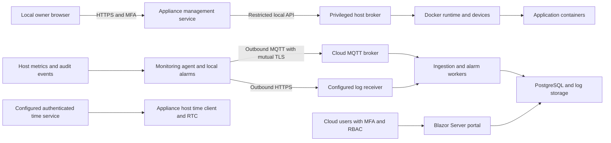

# PiDockPlatform Specification and Implementation Plan

Version 1.1 draft — November 10, 2026.

PiDock turns a Raspberry Pi 5 with an RTC battery into a secure, browser-managed platform for Linux containers and .NET IoT applications. A built-in host agent monitors the appliance, reports through MQTT, evaluates local alarms, and synchronizes selected logs. PiDockCloud provides fleet monitoring, alerting, history, and access control through a Blazor Server application. The same cloud software is available as a self-hosted deployment.

This specification records agreed requirements and proposed implementation defaults. “Must” identifies a release requirement. Numerical defaults and performance budgets are initial engineering targets, to be measured on the reference hardware. This is an implementation specification, not a claim of completed development or security certification.

# Product scope and release boundaries

The first supported appliance is Raspberry Pi 5, ARM64, with a fitted RTC backup battery. The appliance must remain usable without PiDockCloud or internet access, provided its clock remains sufficiently accurate. Cloud enrollment is optional. System monitoring, alarm evaluation, MQTT publishing, and configurable remote log synchronization are built into the first release.

The production reference appliance remains Raspberry Pi 5 ARM64 with an RTC battery. Available development hardware is Raspberry Pi 4 and Raspberry Pi 3 Model B: use the Pi 4 for primary functional testing and the 3B for constrained-memory compatibility tests. Run a 64-bit OS and ARM64 workloads on both, and keep the cloud platform on a separate server. These are test targets until model-specific hardware validation is complete; neither validates Pi 5 secure boot, firmware, RP1 GPIO behavior, or battery-backed RTC holdover. Continuous mains power permits battery-free development tests, but after reboot or power loss require valid time synchronization before TOTP-dependent testing; it does not replace an RTC or trusted-time checks.

The hosted portal is planned for https://pidock.knowledgelocker.ai and deployment through PROX3MUS. Self-hosted installations must support custom domains, certificate authorities, MQTT endpoints, time endpoints, and log destinations without contacting Knowledge Locker for licensing or authentication.

Version 1 includes application image upload and registry pulls, restricted multi-container deployments, local monitoring, automatic capacity-based data retention, live GPIO/interface diagnostics with controlled I/O overrides, files and volumes, networking, device assignments, mandatory local MFA, physical recovery, signed OS updates, MQTT fleet telemetry, notifications, multiple cloud users, RBAC, and backup/restore.

ESP32, Pico, and conventional Arduino boards are companion devices connected through serial, USB, or application protocols; they do not run the PiDock image or Docker. Fleet-wide remote deployment, remote shells, generic cloud file access, application marketplaces, Kubernetes, high-availability cloud clustering, and arbitrary desktop environments are outside version 1. The protocol must reserve room for separately authorized remote control without granting that capability now.

# Reference hardware and supported interfaces

| Item | Version 1 requirement |
| --- | --- |
| Board | Raspberry Pi 5 with 4 GB RAM as the proposed minimum; validate under load |
| Clock | Built-in RTC with official compatible backup battery installed |
| Storage | 32 GB or larger high-endurance microSD minimum; 128 GB SSD recommended for frequent logs and containers |
| SSD connection | USB SSD supported; NVMe requires a compatible PCIe adapter or HAT |
| Power and cooling | Appropriate Pi 5 supply, active cooling, ventilated enclosure |
| Recovery | Attached keyboard and HDMI display as the baseline local console |
| Network | Ethernet and Wi-Fi; country configuration required for wireless operation |
| Optional accessories | GPIO recovery button, compatible camera, UPS, hardware key storage module |

The Pi 5 includes the RTC, but battery-backed retention requires the external battery. Battery presence or state of charge may not be directly measurable; PiDock must not display an invented battery percentage. Record clock continuity checks instead. See [Raspberry Pi hardware documentation](https://www.raspberrypi.com/documentation/computers/raspberry-pi.html#real-time-clock-rtc).

Supported interface classes are GPIO digital input/output, I²C, SPI, PWM where supported, UART and USB serial, Ethernet, USB peripherals, microSD, SSD, HDMI output, and a documented camera path. Pin multiplexing, overlays, permissions, and driver compatibility must be checked before assignment.

Digital GPIO is 3.3 V and is not a native analog input. Analog measurements require an external ADC. PiDock does not provide hard real-time control guarantees. GPIO numbering and examples must use the Pi 5-compatible kernel interfaces rather than assuming older Pi hardware access methods.

Version 1 video certification covers HDMI output from a sample application and one named compatible camera with capture demonstrated inside a restricted container. Arbitrary USB devices, cameras, codecs, GPU acceleration, and HATs are supported only after compatibility testing; supporting an interface does not guarantee every peripheral.

# Architecture and trust boundaries

The appliance runs a minimal Linux host, a Docker-compatible runtime, a small privileged broker, an unprivileged management service, a browser interface, a telemetry agent, and the time client. Applications execute in containers. Platform services are managed by the host and must start independently of application health.

The local management UI uses ASP.NET Core with a lightweight browser frontend; server-rendered pages with small interactive components are preferred for the appliance. The cloud uses Blazor Server, implemented with the supported Interactive Server hosting model.

Cloud monitoring credentials never authorize the local management API. The portal never receives appliance owner passwords or TOTP secrets. Application credentials, device certificates, cloud user credentials, and OS signing keys are separate security domains.

Docker control is effectively privileged. Only the host broker may access the runtime socket. The management frontend sends validated operations over a local Unix socket; it cannot submit arbitrary commands or unrestricted Docker requests. Applications must not mount the runtime socket. [Docker security documentation](https://docs.docker.com/engine/security/) explains the daemon and container configuration trust boundaries.

# Operating system and storage layout

Use a Buildroot-based production image with Pi 5 kernel, firmware, device tree, glibc, systemd, udev, Docker Engine with its runtime dependencies, chrony or an equivalent NTS-capable client, firewall rules, and required storage/network tooling. The exact pinned versions are selected in the compatibility milestone. Buildroot generates the embedded filesystem, kernel, and toolchain; it does not remove the responsibility to maintain their security updates. See the [Buildroot manual](https://buildroot.org/downloads/manual/manual.html).

A disposable Raspberry Pi OS Lite image may be used for early hardware experiments. It is not the production image and must not establish dependencies on manual package installation.

Proposed disk layout: boot metadata; system slot A; system slot B; persistent data. The system slots are read-only. Temporary files use bounded memory-backed storage. Persistent data contains host configuration, protected credentials, application manifests, container layers, named volumes, audit records, and bounded outbound queues.

Filesystem integrity must extend from the signed boot artifacts to the selected root filesystem, using a verified root filesystem such as dm-verity. A signed kernel alone does not protect mutable host services. Writable data is treated as untrusted input and cannot replace system executables.

Use ext4 for managed data volumes in version 1. Provide safe mount/unmount and explicit formatting actions for supported removable storage. Do not automatically execute content or mount untrusted media into privileged services.

Container storage and retained monitoring data require separate budgets. The capacity-based data policy below manages logs, telemetry, audit history, offline queues, and diagnostic captures on the selected data volume. Enforce the host free-space reserve through allocation checks and tested quotas or dedicated partitions. Stop new image pulls and uploads before host-critical storage is exhausted.

# Capacity based data policy

The appliance automatically sizes retained logs and telemetry to the storage it actually uses: microSD by default, or the selected SSD data volume. Use usable mounted filesystem capacity, not the card's advertised size or space occupied by the read-only OS slots. Recalculate after capacity changes and while application usage grows. Never allocate a percentage of instantaneous free space without counting the history already retained.

Let C be usable data-volume capacity, N be allocated space outside the managed history pool, and R be the protected free-space reserve. Proposed defaults are R = max(10% of C, 1 GiB) and a history budget B = min(10% of C, max(0, C − N − R)). N includes application images/volumes, configuration, and filesystem overhead; allocated sizes, including database journals and indexes, count toward usage. Measure effective free space available to the host as an additional guard. The budget grows with larger storage and contracts as application data grows.

| Setting | Safe default |
| --- | --- |
| Total managed history budget | 10% of usable data-volume capacity, reduced to preserve the free-space reserve |
| Protected free-space reserve | Greater of 10% of capacity or 1 GiB |
| Begin routine cleanup | History usage reaches 90% of its effective budget |
| Cleanup target | Reduce usage to 80% of that budget |
| History allocation | Logs 50%, telemetry 30%, audit/events 15%, diagnostic captures 5% |
| Age-based expiry | Optional; disabled for local history by default |
| Policy check | Every 60 seconds, before large writes, and when storage pressure changes |

For a 24 GiB usable data volume, the default history budget is at most 2.4 GiB and the reserve is 2.4 GiB. If non-history data grows to 20 GiB, the effective history budget contracts to 1.6 GiB. These examples describe the data filesystem, not the labeled size of the SD card.

Each class uses bounded segments or partitions. When a class reaches its threshold, purge the oldest records in that class until its cleanup target is reached. Under whole-volume pressure, purge oldest diagnostic captures, ordinary logs, and telemetry before audit/events; audit/events also rotate oldest-first when their own budget is reached. Track record order using durable sequence/ingestion order so an incorrect wall clock cannot make records unpurgeable. Optional age expiry and byte quotas use whichever limit is reached first.

Local chart history and pending uploads share accounted storage wherever practical; any duplicate payloads count toward the same total. Prefer already-synchronized segments for emergency removal, but unsent data is also purgeable when required to protect the host. Record dropped/unsent event counts and sequence gaps in bounded metadata and report them after reconnection. A cloud outage never stops cleanup or creates an unlimited queue.

The collector must reclaim actual allocated space using segment deletion or partition rotation; deleting database rows alone may not release filesystem space. Include active-segment size and concurrent writer reservations in limit checks. Run cleanup incrementally to avoid SD write amplification. If the budget becomes zero or cleanup cannot recover the reserve, stop persistent payload capture, retain only bounded in-memory status, surface an alarm, and reject large storage-consuming operations. Never purge application volumes, credentials, manifests, or OS images as history cleanup.

The Data Policy UI shows storage device, usable capacity, application usage, history usage by class, protected reserve, calculated budget in bytes and percent, oldest retained data, estimated history span, last purge, and dropped/unsynchronized counts. The owner can change the history percentage, class shares, cleanup thresholds, reserve, and optional maximum ages; preview the resulting limits and immediate deletions before applying. Defaults require no manual tuning. Changes are audited and Restore defaults is available. The UI enforces valid threshold ordering, class shares totaling 100%, and a minimum free-space reserve of max(5% of C, 512 MiB); the default reserve remains higher. Storage migration is an explicit operation and does not silently consume a newly attached disk.

Cloud retention remains independently configurable because cloud/server storage is separate. Local automatic purging does not delete data already received by the cloud. The cloud dashboard displays the appliance policy, effective budget, and history loss counters.

# Appliance ownership and first boot

There is exactly one human owner account. Internal service identities are separate and cannot log in interactively. No default password, public setup password, or enabled SSH service is shipped.

First boot enters an unclaimed state. An attached local console displays the device identity and HTTPS certificate fingerprint and generates a short-lived, high-entropy setup token. The token can be entered directly at the console or used once in the browser over HTTPS after fingerprint verification. Setup is disabled when ownership is established.

The setup flow configures networking and time, sets a strong owner password, enrolls an external TOTP authenticator through a QR code or manual secret, and confirms enrollment with consecutive valid codes. Management functions remain unavailable until enrollment completes. A failed or interrupted setup must not leave an unauthenticated administrator endpoint.

Use an established password hashing implementation, such as appropriately configured ASP.NET Core Identity, and benchmark the work factor on Pi 5. Protect TOTP secrets with authenticated encryption under a device-specific key; a TOTP verifier needs the secret and cannot protect it through password hashing alone.

Proposed login policy: password plus six-digit TOTP, 30-second steps, bounded clock tolerance of one step on either side, replay protection persisted across service restarts, progressive throttling after five failed attempts, a 15-minute idle session limit, and an eight-hour absolute limit. Time rollback must not reset replay protection. Use secure, HTTP-only, same-site cookies, CSRF protection, and origin checks on state-changing operations.

A fresh password and TOTP challenge is required for image trust exceptions, network security changes, server trust changes, backup exports containing secrets, and other sensitive operations. Rate limiting must avoid an indefinite remote lockout; physical recovery remains available.

TOTP implementation follows [RFC 6238](https://www.rfc-editor.org/rfc/rfc6238.html). It is not phishing-resistant; a later passkey option can strengthen login without changing the physical-only reset requirement. See [NIST authentication guidance](https://pages.nist.gov/800-63-4/sp800-63b.html).

# Physical recovery and ownership reset

Local means physical presence, not LAN membership. There must be no HTTP, MQTT, cloud, SSH, or remote console operation that resets the owner password, replaces the authenticator, clears ownership, or enables recovery.

Baseline recovery requires a physical console gesture during boot, then confirmation at the attached keyboard and display. An optional dedicated GPIO button may initiate this flow but must not authorize changes by itself. Disable the normal management listener and unnecessary application access during recovery. Recovery mode exposes no network administration service and exits after a short timeout or reboot.

Separate recovery actions are: repair clock state; reset owner credentials and enroll a fresh authenticator; and destructive factory reset. Clearly state the consequences before local execution. A credential reset preserves application data but revokes all owner sessions and rotates local authentication secrets. A factory reset erases credentials, deployment configuration, device identity, and managed data according to the selected scope; external disks are never silently erased.

Credential recovery must work without the old password or cloud access. Therefore a person with authorized physical access can take ownership of an unlocked appliance and its preserved data. Stronger protection against physical theft requires a separate unlock factor or hardware-backed key design; it cannot be promised by TOTP or recovery UX.

Network MFA recovery codes are not issued for the appliance. An authenticated owner may change credentials through the physical workflow; secret replacement and reset stay physically gated. Cloud account recovery is a separate documented process and cannot invoke appliance recovery.

Record recovery events durably and forward them after connectivity returns. Local deletion or offline modification can defeat local-only audit storage; remote records provide evidence already received, not proof against a fully compromised host.

# Time synchronization and offline authentication

A host-level time service owns the system clock; applications cannot set it. Each device synchronizes using NTP with NTS against the selected cloud service or approved alternative endpoints. The server package includes an optional NTS service profile. UTC is used for storage and protocols; time zones affect display only.

The cloud NTS service must discipline time against independent upstream sources. It must not assume that packaging a time daemon in a container makes the host clock correct. Host clock control is handled by the host administrator or a narrowly privileged, separately reviewed time-service deployment.

Track time state as synchronized, acceptable RTC holdover, or untrusted. Store the last trusted time, boot ID, sync metadata, and replay state. Read the RTC on boot; after authenticated synchronization, write corrected time back to it. Evaluate trust using elapsed time and a measured drift allowance compatible with the TOTP window, not a permanent “battery installed” flag.

NTS itself uses TLS and requires a plausible starting clock. On first provisioning, or after RTC failure, use the physical console to establish a reasonable initial date before validating certificates and synchronizing. Never solve bootstrap by disabling certificate checks or accepting unauthenticated network time.

If clock trust is lost, existing application workloads continue. New owner logins and clock-sensitive privileged authentication are blocked until trusted synchronization or physical repair. Existing sessions cannot be extended through wall-clock rollback; use monotonic time for session lifetimes, cooldowns, and durations.

The authenticator phone maintains its own clock; the cloud cannot force it to match. TOTP verifier code and policy are shared between products, but local and cloud secrets are distinct. Test RTC drift during extended power-off periods and explicitly show clock health. Authenticated time transport follows [RFC 8915](https://www.rfc-editor.org/rfc/rfc8915.html).

# Application deployment and isolation

Support Linux ARM64 images from authenticated registries and Docker image archives. Validate archive structure, architecture, expanded size, available disk, image metadata, and checksum before import. Do not support image builds on the appliance in version 1.

Store a versioned deployment manifest containing image digest, service names, command and arguments, environment references, secrets, ports, volumes, device grants, network policy, health checks, startup ordering, resource limits, restart policy, and update policy. Pin deployments to immutable image digests.

Provide a documented subset of Compose for multi-container applications. Reject unsupported or dangerous fields rather than silently ignoring them. Translate the accepted manifest into runtime operations; do not execute arbitrary Compose or shell content. The UI offers validate, deploy, start, stop, restart, inspect logs, and remove with separate data-deletion confirmation.

Default restrictions: non-root container users where the image supports them, dropped capabilities, no privilege escalation, seccomp, an enabled mandatory access-control profile, private app networks, read-only roots where supported, explicit writable volumes, CPU/memory/process limits, and bounded logs. Validate the selected Linux security module on the production kernel.

Reject privileged mode, host PID namespace, host root mounts, Docker socket access, raw block-device access, and writable host system paths. Host networking and broad USB bus access are unavailable by default. Narrow exceptions require a named policy, fresh owner MFA, and an audit event; some capabilities may remain unsupported.

Require trusted signatures for PiDock OS and platform packages. For user application images, support trusted publisher keys and signature verification, with unsigned images requiring explicit local-owner approval bound to the digest. A digest identifies content but does not establish publisher trust.

Before applying an update, preserve the previous manifest and image reference. Health checks determine promotion. Application rollback does not reverse database migrations or volume changes; backups or application-specific migration support are required for those operations.

# Device access files and networking

Use an inventory service for GPIO chips, buses, serial adapters, supported USB peripherals, network interfaces, disks, cameras, and display resources. Assign stable aliases using serial numbers and physical paths where possible. Handle removal and reconnection without accidentally assigning a different peripheral.

A deployment requests specific device nodes, access modes, and groups. The broker validates these requests against the owner’s grants. Bus ownership and pin conflicts must be displayed. Hardware interfaces may require reboot to apply overlays.

The file browser is restricted to managed application data, approved shares, and attached storage. Host secrets, system partitions, runtime internals, and other protected paths are inaccessible. Enforce traversal and symlink protections at open time, including race conditions. Support upload, download, rename, folders, delete, safe archive extraction, and per-volume usage. Preview logs as escaped text.

Network settings include hostname, Ethernet/Wi-Fi, DHCP/static addressing, DNS, country, and trusted service endpoints. Network changes use a confirmation timer with automatic rollback, so a bad configuration does not permanently strand the administrator.

The host firewall defaults to deny inbound traffic except explicitly permitted management access and approved application ports. Enforce container port policy in the actual Docker packet path, not just the host input chain. Cloud connections are outbound. LAN access is not treated as proof of trust.

HTTPS is mandatory for management. Provision a unique local certificate and physically verifiable fingerprint; support a user-managed certificate or local CA. Certificate changes are audited. A VPN or deliberate firewall rule can permit remote browser administration, but PiDock does not automatically expose or relay its management interface through the cloud.

# Live GPIO and interface diagnostics

The local UI includes a live Pi 5 40-pin header diagram and an interface inventory. Each pin shows physical header number, GPIO name, function, input/output direction, bias where reported, logical state, active-low configuration, consumer/application owner, availability, last update, and whether an override is active. Fixed power/ground pins are identified and never controllable. Alternate-function pins are shown as bus functions rather than ordinary digital outputs.

Use event-driven edge updates when available, coalesced for browser display with a proposed maximum 10 updates per second; interface counters refresh once per second. Label stale, unknown, inaccessible, and app-reported values explicitly. This is live troubleshooting rather than a hard real-time logic analyzer; brief pulses can exceed display resolution and dropped trace events must be counted.

GPIO access uses the Linux character-device API through the host broker. Linux line requests are exclusive, so observing an app-owned line cannot assume a second read request will work. For full state visibility, offer a broker-backed I/O API with a small .NET client that applications may use; direct-access containers remain supported, but their live values may require cooperative instrumentation or a supported driver. Do not silently seize a line to inspect it. See the [Linux GPIO API](https://docs.kernel.org/userspace-api/gpio/chardev.html) and [line request semantics](https://docs.kernel.org/userspace-api/gpio/gpio-v2-get-line-ioctl.html).

The owner can select an eligible output and force high/low, issue a bounded test pulse, or adjust supported PWM duty/frequency. Enabling maintenance control requires fresh MFA and shows the selected pin, current owner, requested operation, configured fallback, and affected app. Only one owner of the line is allowed: use an acknowledged broker handoff or stop the consuming app and confirm that the line has been released before takeover. System-reserved pins and active buses cannot be overridden as digital GPIO.

Each override is a broker-enforced lease, defaulting to 60 seconds with explicit renewal and a clear Release control. A monotonic timeout, logout, lost browser heartbeat, or service restart ends the lease and applies the configured per-pin fallback before an explicit app handback. Do not automatically replay a previous output value or restart an app into an unreviewed state. Override and fallback state are persisted for startup reconciliation; the UI highlights forced lines and audits start, changes, release, expiry, and handback.

An input cannot be electrically forced high/low while remaining an input. Offer a separately labeled simulated-input override for broker-backed applications, or an explicit maintenance direction change on an eligible, released pin. Simulation never appears as a measured voltage. Direction changes, pulses and PWM remain subject to configured electrical limits.

The fallback must be chosen for the attached equipment; there is no universal safe high/low value. Closing a GPIO handle or losing host power does not guarantee a particular output state. External pull resistors, interlocks, or watchdog hardware are required where equipment needs a guaranteed fail-safe state. Validate broker crash behavior during the hardware milestone and document the remaining hardware boundary.

| Interface | Built-in live health and troubleshooting |
| --- | --- |
| Ethernet and Wi-Fi | Link/address state, signal where available, RX/TX rates, drops/errors, reconnects, filtered device-local packet capture |
| UART and USB serial | Connection/configuration, byte rates, framing/parity/overrun counters where reported; timestamped text/hex traffic through a broker proxy or cooperative app tracing |
| I²C and SPI | Bus configuration, assigned consumers, transaction/error/timeout counters and decoded app/driver-assisted traces where supported |
| USB | Device enumeration, reconnects, transfer/error counters where available, filtered USB traces through the host broker |
| SD and SSD | Capacity, read/write throughput, latency/errors, filesystem state, available health indicators |
| Camera and display | Device/driver presence, stream/display state and available frame/error counters |

Opening a UART a second time can consume or disrupt the application's data; generic passive serial capture is not promised. I²C/SPI bus sniffing requires cooperative tracing, driver support, or external analyzer hardware. Do not issue automatic discovery scans or test transactions on a running bus. Label unsupported measurements rather than guessing.

Traffic capture is off by default. The owner explicitly chooses interface, device/flow filter, metadata or payload, duration and byte cap. Defaults are 60 seconds and the smaller of 16 MiB or the capture-class budget; disable persistent capture if no budget remains. Use a bounded RAM preview, then optional policy-managed export. Network capture covers traffic visible to this appliance, not arbitrary traffic elsewhere on the LAN. USB traces reflect kernel requests and may not reproduce physical bus traffic exactly, as described in [Linux usbmon documentation](https://docs.kernel.org/usb/usbmon.html).

Exclude recovery/input keyboards and authentication-bearing management traffic from routine payload capture; do not claim encrypted payloads can be decrypted. Escape displayed text, restrict downloads to the owner, and disable automatic cloud upload of raw traces. Cloud log readers do not automatically gain capture access. Cloud monitoring may receive interface counters and override audit events, but cloud users cannot force pins or start captures in version 1.

The .NET developer sample demonstrates broker-backed GPIO monitoring, exclusive control handoff, simulated input, and serial tracing. The dashboard shows when a direct-access application cannot provide these capabilities.

# Monitoring alarms and log synchronization

Monitoring runs outside application containers and starts even if Docker fails. Collect host CPU, memory, swap, temperature, throttling, uptime, clock state, filesystem space/inodes, network counters, container health/restarts/resource usage, update state, certificate expiry, and available storage health indicators. Mark unavailable measurements explicitly.

Initial defaults: host and container sampling every 15 seconds; heartbeat every 30 seconds; remote raw samples every 30 seconds. Limit metric cardinality and avoid arbitrary user-controlled labels. Local charts, offline uploads and diagnostic history use the capacity-based data policy. Live GPIO and interface streams use the separate rates defined in the diagnostics section.

Initial alarm examples: disk warning at 80% and critical at 90%; sustained memory pressure above 85%; temperature above a provisional 80°C; restart loops; unhealthy or stopped required containers; repeated failed logins; recovery activity; clock failure; certificate expiry; and telemetry/log queue overflow. Temperature and resource thresholds must be tuned against Pi 5 measurements.

Each rule defines severity, scope, threshold, duration, hysteresis, cooldown, maintenance suppression, routing, and recovery behavior. Suggested defaults are a five-minute duration and a 15-minute repeat cooldown for resource warnings; security events may trigger immediately. Alarm transitions are durable events with unique IDs.

Local rules operate offline. The cloud independently detects lost contact and evaluates fleet rules. Display last-seen time, data freshness, and whether a value is delayed. Proposed offline default: mark stale after 90 seconds and open an offline incident after three minutes. A broker Last Will is advisory, not the only offline detector.

Log collection supports host service logs, audit logs, and opt-in container stdout/stderr. Configurable destinations include the PiDock HTTPS batch receiver and syslog over TLS; connectors share bounded queues and explicit credential handling. Include timestamps, device ID, boot ID, source, severity, sequence, and event ID. Redact secrets and authentication material; never log TOTP values, enrollment QR data, tokens, or private keys.

Local telemetry, logs, audit/events and diagnostic captures use the capacity-based data policy instead of fixed MiB spool limits or mandatory local retention days. Oldest eligible data is purged automatically within each class, even during outages. Report purge activity, effective limits, remaining reserve, and unsynchronized data loss; no history class can grow without a bound.

Use exponential reconnect backoff with jitter, bounded batch sizes, priority lanes, and monotonic retry timers. Acknowledge HTTPS batches only after durable acceptance. Protect endpoints against malicious log rendering, decompression bombs, and excessive payloads.

# MQTT protocol device identity and enrollment

Use MQTT 5 over TLS, with TLS 1.2 as the minimum and TLS 1.3 preferred. Disable anonymous access and plaintext listeners. Each appliance generates its own private key and submits a certificate signing request during enrollment; the private key never leaves the appliance.

An authorized cloud administrator creates a short-lived, single-use enrollment token scoped to an organization. The authenticated local owner selects the endpoint and confirms its TLS trust, then presents the token and CSR over HTTPS. The server issues a device-specific certificate and identifier. Default proposed leaf lifetime is 90 days, with renewal starting 30 days before expiry. CA signing keys must not be embedded in portal images.

Bind broker authorization to the verified certificate identity and its server-side organization/device mapping. A client-supplied username, topic, or payload cannot choose its tenant. Enforce publish ACLs, subscription ACLs, payload/rate/connection limits, and rejection of a certificate used as another device. Do not expose broker administration topics to appliances. Certificate/ACL integration must be proven together; enabling a broker plugin alone is not evidence of isolation. See [Mosquitto configuration](https://mosquitto.org/man/mosquitto-conf-5.html).

Versioned topic layout:
- `pidock/v1/tenants/{tenantId}/devices/{deviceId}/telemetry`
- `pidock/v1/tenants/{tenantId}/devices/{deviceId}/events`
- `pidock/v1/tenants/{tenantId}/devices/{deviceId}/status`

Devices may publish only to their own allowed topics. They have no command subscriptions in version 1. Ingestion workers receive only the subscriptions they require. Browsers receive authorized data from the portal, never broker administrator credentials.

Use QoS 1 for alarms and significant events, with server-side deduplication; delivery may be repeated. Use QoS 0 for disposable live samples and deduplicated QoS 1 batches for buffered history. Retain only sanitized current status, not logs or credentials. Configure bounded session/message expiry.

Each message includes schema version, device ID, boot ID, sequence, message ID, observed UTC time, clock state, and typed payload. The server records received UTC time and validates identity against the connection. Proposed maximum MQTT payload is 64 KiB; larger history is split into bounded batches.

Revocation must terminate active sessions and deny reconnection. Devices with expired credentials cannot bypass TLS checks; re-enrollment requires a new token and local-owner authentication, with physical clock repair when needed. Moving to another server or tenant clears old queues and certificates, requires local approval, and prevents cross-tenant history leakage. Monitoring software identifies the authenticated device; it cannot prove the truth of telemetry from a compromised host.

# Cloud services and user experience

Implement on .NET 10 LTS with ASP.NET Core, Blazor Interactive Server, Identity, Entity Framework Core, PostgreSQL, a maintained MQTT broker such as Mosquitto, and separate background workers. Pin supported patch versions and container digests. .NET 10 is an LTS release; use the official [support policy](https://dotnet.microsoft.com/en-us/platform/support/policy/dotnet-core) when selecting and updating versions.

The web service handles accounts, organizations, fleets, enrollment, dashboards, alarm rules, notification destinations, downloads, and settings. It does not need the appliance runtime socket or a privileged host mount.

Workers ingest MQTT data, accept log batches, deduplicate events, aggregate telemetry, evaluate alarms, and deliver notifications through a durable outbox. Worker restarts must not lose acknowledged events or resend unbounded duplicate notifications.

The UI includes:
- Fleet overview with online, stale, offline, warning, and critical state.
- Device detail with charts, containers, clock/certificate health, alarm history, and authorized logs.
- Alarm inbox with acknowledge, assign, resolve, silence, and audit history.
- User/role management and device enrollment/revocation.
- Notification routing, retention, backup status, and self-hosted server health.
- Downloads for appliance images, signatures, release notes, and server packages.

The first release supports in-app notifications, SMTP email, and signed HTTPS webhooks. Tenant-configured outbound URLs must be checked against SSRF, DNS rebinding, and access to metadata endpoints or private services unless explicitly allowed by the self-host administrator. Webhooks use timeouts, bounded retries, HMAC signatures, and delivery IDs.

The portal requires working WebSocket forwarding, appropriate idle timeouts, secure cookies, proxy trust configuration, and circuit reauthorization. Enforce authorization at service/API and data-access boundaries, not only by hiding UI components. See [Blazor security documentation](https://learn.microsoft.com/en-us/aspnet/core/blazor/security/?view=aspnetcore-10.0).

# Cloud tenancy authentication and RBAC

Cloud users may belong to multiple organizations. An organization contains fleets and devices. Membership and grants are scoped; cross-organization access is denied by default.

Require MFA for all human users. Use password plus external TOTP initially, with separate cloud enrollment secrets. Invitations are single-use and expire. Recovery uses a documented verified-email/recovery-code process with notifications, session revocation, and audit records. Self-hosted bootstrap requires a local deployment-generated one-time token, not a public first-user-wins registration page.

| Role | Default capabilities |
| --- | --- |
| Owner | Organization settings, ownership, administrators, retention and deletion |
| Administrator | Users below own authority, fleet/device management, enrollment, revocation, alarms and destinations |
| Operator | View telemetry, acknowledge incidents, configure permitted alarm rules |
| Viewer | Read authorized telemetry and incident state |
| Auditor | Read security audit records and approved exports without configuration rights |

Log access and exports are explicit sensitive permissions, not automatic consequences of viewing telemetry. Grant scope may be organization, fleet, or device. Effective permissions are evaluated against the selected tenant and resource; identifiers alone never grant access. Users cannot grant a role or scope they do not possess. Platform maintenance identities and tenant roles remain distinct.

Use server-enforced tenant predicates plus PostgreSQL row-level security as defense in depth, with an application database role that cannot bypass the policies. Background jobs carry explicit tenant context. Automated tests must attempt access through guessed IDs, exports, charts, logs, notifications, caches, and real-time subscriptions.

Access revocation terminates or invalidates active sessions and subscriptions promptly. Audit identity, tenant, action, target, outcome, event/receipt times, and correlation ID. Audit storage is append-oriented with restricted writers; administrators with direct host/database access remain a higher trust boundary.

Neither an organization owner nor the cloud platform administrator can reset an appliance owner account. Cloud revocation can disconnect monitoring; it cannot silently transfer local ownership.

# Data contracts retention and backups

Core entities: User, Organization, Membership, PermissionGrant, Fleet, Device, DeviceCertificate, EnrollmentToken, TelemetrySample, TelemetryAggregate, Event, AlarmRule, Incident, NotificationDestination, NotificationDelivery, LogBatch, AuditRecord, and BackupRecord. Deployments and device grants are authoritative locally; any cloud inventory copy is informational.

Every tenant-owned record includes tenant ID. Every ingested event includes server receipt time and a unique device/message key. Use partitioned telemetry tables and bounded queries. High-cardinality raw logs are compressed into segment files or an S3-compatible store with searchable metadata in PostgreSQL; do not load unlimited logs into the relational database by default.

Proposed cloud retention: raw telemetry seven days; five-minute aggregates 90 days; hourly aggregates one year; synchronized logs 14 days; incidents and security audit records one year. These server-side settings are configurable within server quotas. Appliance history instead follows its capacity-based data policy, with optional age limits and clear data export behavior.

Back up cloud database, log segments/object references, broker ACL state, certificate authority material, application secret-encryption keys, and ASP.NET Core Data Protection keys. Encrypt backups using keys stored separately from backup media. A database backup without required cryptographic keys is not a recoverable deployment.

Appliance backups include deployment manifests, selected data volumes, and configuration. Authentication/device identity material is excluded from portable backups by default. Restoring onto a different appliance requires physical setup and cloud enrollment, preventing cloned identities. Consistent database/container data backups require application quiescing or application-aware hooks.

Initial self-hosted recovery targets: RPO 24 hours and RTO four hours for a documented reference installation; these are validation targets, not a hosted service SLA. Test full restoration onto a clean server and verify tenant isolation, certificates, log references, and notifications afterward.

# Self hosted package and PROX3MUS deployment

Distribute identical application images for hosted and self-hosted use, with Linux AMD64 and ARM64 server images where supported. Version 1 supports a single server through Docker Compose; no Kubernetes dependency. Provide versioned manifests, a sample configuration, a setup validator, upgrade/rollback instructions, backup/restore procedures, signatures, and an SBOM.

Baseline services are reverse proxy, portal/API, ingestion/alarm/notification workers, MQTT broker, PostgreSQL, and persistent log storage. The optional authenticated time profile can run alongside them when the host provides the required networking and clock privileges. A deployment may instead configure trusted external NTS sources without weakening appliance authentication.

| Port | Purpose and exposure |
| --- | --- |
| TCP 443 | Portal, enrollment, logs and APIs through HTTPS |
| TCP 8883 | MQTT over TLS for device connections |
| UDP 123 | Optional NTP/NTS time traffic |
| TCP 4460 | Optional NTS key establishment |
| PostgreSQL and internal service ports | Private deployment network only |

Time and MQTT services require TCP/UDP or layer-four exposure; an HTTPS-only web proxy does not provide these automatically. Keep the database and broker administration interfaces private.

PROX3MUS integration is specified as a deployment contract until its capabilities are verified: immutable image delivery; environment and secret injection; persistent volumes; domain/TLS management; WebSocket support; TCP 8883 and optional UDP 123/TCP 4460 routing; health checks; migration jobs; restart ordering; backup scheduling; rollback; and deployment audit output. If raw time ports are unavailable, use a separate approved NTS endpoint. If MQTT TCP exposure is unavailable, evaluate an explicitly supported MQTT-over-WebSockets endpoint before choosing another broker location.

The hosted deployment uses pidock.knowledgelocker.ai for the portal. Broker and time hostnames are selected during infrastructure setup and need not share that hostname. There is no assumption that DNS, certificates, PROX3MUS access, or servers have already been provisioned.

Initial self-hosted sizing target: four virtual CPUs, 8 GB RAM, SSD-backed storage, and 100 devices reporting at 30-second intervals, excluding high-volume logs. Benchmark ingestion, live Blazor circuits, and storage growth before publishing capacity guidance. Larger installations scale workers and storage according to measured load.

# Platform security updates and release engineering

Threat model: hostile LAN clients, stolen cloud credentials, compromised application containers, malicious images and archives, broker abuse, cross-tenant requests, log injection, supply-chain compromise, physical access, storage exhaustion, and unreliable power/connectivity.

Use least-privilege host services, protected local sockets, syscall restrictions, bounded resource use, disabled debug endpoints, hardened TLS, dependency patching, and restricted outbound destinations where practical. Encrypt secrets at rest, but do not claim that a software key stored on removable media protects against an attacker who can read the entire device. Strong physical key protection is a separate hardware/provisioning requirement.

Use signed A/B OS images with authenticated metadata, root integrity checks, boot-attempt limits, health-based slot promotion, and tested fallback. An update must be verified before it can replace a boot candidate. Schema migrations for persistent configuration must be backward compatible or recoverable through snapshots.

Distinguish health rollback from security rollback: permit the last known good slot only within the signed allowed-version policy. A hardware-enforced anti-rollback guarantee is not assumed. Verify the Pi 5 firmware revision and secure-boot flow on production hardware; the trust chain must protect recovery and both boot slots as well as normal startup.

Pi 5 secure boot requires provisioning and can involve irreversible one-time-programmable settings. Development boards remain explicitly marked development devices; the production security profile is enabled only through a documented, verified provisioning procedure. Provision signing keys and test signed recovery before locking production hardware. See [Raspberry Pi secure boot documentation](https://github.com/raspberrypi/usbboot/blob/master/docs/secure-boot.md).

Keep release signing keys offline or in a signing service with controlled access. Online device certificate issuance uses a separate limited intermediate CA. Plan key rotation, revocation, expiry, compromised release response, and signed trust updates before general availability.

CI produces firmware/image manifests, application containers, SBOMs, dependency/license reports, provenance, and signatures. Use patch releases for security fixes and a published maintenance policy. Customer deployment policy controls automatic installation windows, while the appliance and portal clearly report unsupported versions.

# Failure behavior and engineering budgets

| Condition | Required behavior |
| --- | --- |
| Internet/cloud outage | Apps, local UI with trusted clock, local alarms and bounded logging continue |
| Broker or receiver unavailable | Backoff and bounded buffering; show queue age and dropped counts |
| RTC battery failure or implausible clock | Apps continue; protected login waits for trusted time or physical repair |
| Expired/revoked device certificate | No insecure fallback; queue within limits and require approved renewal/re-enrollment |
| Application fills its volume | Quota enforcement protects host operation and security queues |
| Docker fails | Host management, time and monitoring remain available |
| Network misconfiguration | Confirmation timeout restores previous working configuration |
| Power loss during OS update | Boot a verified slot; do not execute partial images |
| Corrupt app data | Surface failure; do not claim OS rollback repairs it |
| Cloud worker crash | Replay/deduplicate durable events and resume notification outbox |

Initial appliance budgets on the reference Pi 5: under 512 MiB steady platform memory excluding application containers and reclaimable cache; under 3% of total four-core CPU capacity at idle with five mostly idle sample containers; management available within 60 seconds on SSD; p95 local read-only UI/API operations under one second excluding bulk transfers. Measure and revise before declaring supported capacity.

Time/client authentication and management must start without cloud availability. Cloud live-data refresh target is within 60 seconds under normal connectivity. Test prolonged outages, at least 72 hours for buffering behavior, and RTC holdover over progressively longer powered-off intervals. No guarantee of indefinite offline TOTP accuracy is made.

# Implementation phases and deliverables

The plan assumes two experienced engineers with dedicated security review and hardware test time. A preliminary 18–26 week range is a planning allowance, not a commitment. Hardware compatibility, verified boot/update work, and PROX3MUS integration are the principal schedule uncertainties.

| Phase | Indicative duration | Deliverables and exit gate |
| --- | --- | --- |
| 0 Requirements and threat model | 1 week | Accepted scope, abuse cases, trust diagram, recovery UX, hardware BOM and decision records |
| 1 Compatibility prototypes | 2–3 weeks | Pi 4 primary and Pi 3B constrained-resource ARM64 tests on a temporary Linux test image; .NET, Docker, network time and GPIO/serial samples; subsequent Pi 5 Buildroot, RTC battery, RP1 I/O and secure boot/update validation; PROX3MUS capability report |
| 2 Appliance foundation | 3–4 weeks | Repeatable image build, host broker, read-only root, capacity-based history cleanup, network rollback, local HTTPS and commissioning |
| 3 Authentication and application management | 3–4 weeks | Mandatory password/TOTP, replay protection, physical recovery, manifest validation, files, device grants, live GPIO/interface view, timed I/O overrides and restricted multi-container deployment |
| 4 Monitoring vertical slice | 2–3 weeks | Local metrics/alarms, per-device enrollment, mTLS MQTT, HTTPS logs, policy-managed offline queues, bounded traffic traces, basic cloud device dashboard |
| 5 Cloud and self hosting | 3–4 weeks | Tenant RBAC, history, alarm inbox, email/webhooks, retention, backup/restore, Compose distribution and PROX3MUS staging |
| 6 Production hardening and beta | 4–5 weeks | Signed A/B updates, verified boot/root integrity, fault injection, restore drills, independent security review, operator docs and release candidate |

Some work overlaps after the compatibility gate; ranges must be re-estimated from measured results. Build telemetry message contracts and the first cloud ingestion path during the appliance phases so IoT support is part of the architecture from the beginning, not retrofitted.

Milestone A is a development-only image that boots offline, keeps time, runs a sample app, and reports to a self-hosted server. Milestone B is a private beta with enforced authentication/recovery and complete monitoring. General availability requires the production hardening gate; beta convenience settings cannot silently become production defaults.

# Work breakdown and repository structure

Proposed solution layout:
- `src/PiDock.Contracts`: versioned MQTT, log and API contracts.
- `src/PiDock.Security`: reusable TOTP policy, credential primitives and contract validation without sharing secrets.
- `src/PiDock.Appliance.Web`: local management UI and authenticated API.
- `src/PiDock.Appliance.Agent`: metrics, local rules, spooling and outbound connections.
- `src/PiDock.Appliance.Broker`: narrow privileged operations and runtime integration.
- `src/PiDock.Cloud.Web`: Blazor portal and tenant administration.
- `src/PiDock.Cloud.Worker`: ingestion, alarms, aggregation, retention and notification outbox.
- `src/PiDock.Cloud.Persistence`: schema, migrations and tenant-enforced queries.
- `os/`: Buildroot external tree, kernel/firmware configs, partitions, integrity and updates.
- `deploy/`: self-hosted Compose, time-service profile and PROX3MUS deployment definitions.
- `samples/`: .NET GPIO, serial, web app, camera/display and multi-service examples.
- `tests/`: protocol/security integration suites, hardware acceptance and fault injection.
- `docs/`: installation, recovery, application authoring, hosting and maintenance.

Early implementation tickets, in order: capture decisions and supported hardware; build a repeatable Pi 5 image; validate .NET/native dependencies on the production libc; prove RTC and NTS startup; exercise restricted GPIO and serial containers; prove signed boot plus verified root and slot recovery; confirm PROX3MUS transport/persistence; define contracts; implement ownership and physical recovery; implement a single device-to-cloud telemetry path. Do not spend the first milestone polishing dashboards before these constraints are proven.

# Release acceptance and security verification

| Test area | Required evidence |
| --- | --- |
| Ownership | Unclaimed device has no general admin access; setup tokens expire and are single-use; MFA enrollment cannot be bypassed |
| Local login | Correct and incorrect codes, replay, skew, clock rollback, throttling, service restart and session expiry tested |
| Physical recovery | Network scans and API/MQTT attempts cannot trigger reset; console process works with cloud disconnected and revokes sessions |
| Time | Battery-backed power-off retention measured; dead RTC, wrong date, blocked NTS and certificate-bootstrap cases handled without insecure fallback |
| Runtime isolation | Malicious app cannot read owner secrets, access runtime socket, change clock or obtain unassigned devices |
| Files and inputs | Traversal, symlink races, malicious archives, oversized uploads, escaped log display and SSRF tests pass |
| Networking | Container ports respect policy; Wi-Fi/static address failure rolls back; HTTPS trust workflow is usable |
| MQTT | Wrong cert, wrong topic, forged tenant ID, duplicate events, revocation, reconnection and floods are rejected or bounded |
| Tenancy | Cross-tenant IDs, exports, log queries, caches and live subscriptions cannot disclose data |
| Offline behavior | Apps and alarms continue; queues stay within budget; replay does not duplicate incidents or notifications |
| Updates | Unsigned/tampered image rejected; power interrupted at update stages; fallback and data compatibility verified |
| Cloud recovery | Restore onto a clean host within measured targets; all required keys and persistent data accounted for |
| Hardware | GPIO, serial, USB SSD, SD, Ethernet, Wi-Fi, camera and HDMI reference scenarios demonstrated |
| Data policy | Different SD/SSD capacities, app growth, quota changes, full volume/inodes, unacknowledged data, clock rollback and power loss during purge; actual free space and protected files verified |
| Live I/O | Correct Pi 5 mapping, ownership visibility, stale/unknown states, simulated versus physical values, exclusive override handoff, expiry/disconnect/restart fallback and audit records |
| Interface traces | Serial traffic is not consumed twice; unsupported sniffing is labeled; filters, redaction/exclusions, capture caps, auto-stop and no default cloud trace upload verified |
| Capacity | Appliance budgets and a 100-device cloud workload measured with published test conditions |

Use unit tests for security-sensitive logic and contract compatibility; integration tests for broker ACLs, database policies, queues and migrations; real Pi hardware tests for clock, I/O, boot, recovery and power loss. An emulator is insufficient for secure boot or RTC acceptance.

Before public release, complete a security review focused on privileged broker boundaries, recovery, tenant isolation, update signing, device identity and input processing. Release artifacts include installation/recovery guides, supported-device matrix, security limitations, disclosure contact, self-hosting guide, tested upgrade path and known issues.

# Decisions to validate before implementation commitments

Agreed: Pi 5 with RTC battery; one appliance owner; mandatory external authenticator; physically gated resets; independent local verification; authenticated time synchronization; built-in MQTT monitoring/alarms/log forwarding; automatic capacity-based history purging with editable UI defaults; live GPIO/interface monitoring, controlled I/O forcing and bounded traffic diagnostics; multi-user cloud RBAC; Blazor Server; hosted portal and equivalent self-hosted distribution.

Proposed defaults in this specification: Buildroot/glibc/systemd production host, .NET 10 LTS, Docker Engine, PostgreSQL, Mosquitto, SMTP/webhooks, restricted Compose support, 4 GB minimum appliance RAM, software-protected secrets with explicit physical limits, and optional packaged NTS service.

Compatibility gates decide: exact kernel/runtime package versions; root integrity/update tooling and Pi 5 firmware constraints; hardware-backed secret protection requirements; supported camera/display combination; measured RTC holdover policy; PROX3MUS capabilities; production image signing authority and customer-managed signing model.

The signed production profile, local recovery design and tenant isolation are release gates. If a prototype reveals a conflict, update the specification and threat model before changing those guarantees.
