# PiDockPlatform Specification and Implementation Plan

Version 1.3 draft — November 12, 2026.

PiDock turns a Raspberry Pi 5 with an RTC battery into a secure, browser-managed platform for Linux containers and .NET IoT applications. A built-in host agent monitors the appliance, reports through MQTT, evaluates local alarms, and synchronizes selected logs. PiDockCloud provides fleet monitoring, alerting, history, and access control through a Blazor Server application. The same cloud software is available as a self-hosted deployment.

This specification records agreed requirements and proposed implementation defaults. “Must” identifies a release requirement. Numerical defaults and performance budgets are initial engineering targets, to be measured on the reference hardware. This is an implementation specification, not a claim of completed development or security certification.

# Product scope and release boundaries

The first supported appliance is Raspberry Pi 5, ARM64, with a fitted RTC backup battery. The appliance must remain usable without PiDockCloud or internet access, provided its clock remains sufficiently accurate. Cloud enrollment is optional. System monitoring, shared application APIs, centralized logging and alarm evaluation, an agent MCP interface, MQTT publishing, and configurable remote log synchronization are built into the first release. Define and validate these application platform contracts before developing hosted product applications; conformance samples are part of platform development.

The production reference appliance remains Raspberry Pi 5 ARM64 with an RTC battery. Available development hardware is Raspberry Pi 4 and Raspberry Pi 3 Model B: use the Pi 4 for primary functional testing and the 3B for constrained-memory compatibility tests. Run a 64-bit OS and ARM64 workloads on both, and keep the cloud platform on a separate server. These are test targets until model-specific hardware validation is complete; neither validates Pi 5 secure boot, firmware, RP1 GPIO behavior, or battery-backed RTC holdover. Continuous mains power permits battery-free development tests, but after reboot or power loss require valid time synchronization before TOTP-dependent testing; it does not replace an RTC or trusted-time checks.

The hosted portal is planned for https://pidock.knowledgelocker.ai and deployment through PROX3MUS. Self-hosted installations must support custom domains, certificate authorities, MQTT endpoints, time endpoints, and log destinations without contacting Knowledge Locker for licensing or authentication.

Version 1 includes individually uploaded application packages, registry pulls, tenant-scoped versioned application publishing and distribution through the registered PiDockCloud instance, restricted multi-container deployments, local monitoring, automatic capacity-based data retention, live GPIO/interface diagnostics with controlled I/O overrides, files and volumes, networking, device assignments, mandatory local MFA, physical recovery, signed OS updates, MQTT fleet telemetry, notifications, multiple cloud users, RBAC, and backup/restore. USB-connected expansion nodes are an agreed product requirement with staged implementation and separate hardware acceptance gates; their production availability must be explicitly declared in the supported-device matrix and must not be inferred from single-appliance version 1 support.

ESP32, Pico, and conventional Arduino boards are companion devices connected through serial, USB, or application protocols; they do not run the PiDock image or Docker. Unattended fleet-wide installation, remote shells, generic cloud file access, application marketplaces, Kubernetes, high-availability cloud clustering, and arbitrary desktop environments are outside version 1. Cloud package distribution does not itself authorize installation: the local owner approves an exact release or explicitly grants a scoped installation/update policy. Broader remote control remains separately authorized.

# Reference hardware and supported interfaces

| Item | Version 1 requirement |
| --- | --- |
| Board | Raspberry Pi 5 with 4 GB RAM as the proposed minimum; validate under load |
| Clock | Built-in RTC with official compatible backup battery installed |
| Storage | 32 GB or larger high-endurance microSD minimum; 128 GB SSD recommended for frequent logs and containers |
| SSD connection | USB SSD supported; NVMe requires a compatible PCIe adapter or HAT |
| Power and cooling | Appropriate Pi 5 supply, active cooling, ventilated enclosure |
| Recovery | Attached keyboard and HDMI display as the baseline local console |
| Network | Ethernet and Wi-Fi; country configuration required for wireless operation |
| Optional accessories | GPIO recovery button, compatible camera, UPS, hardware key storage module |
| Expansion connection | Supported nodes use their USB-C port for power, discovery, provisioning and ongoing communication; no Ethernet cable or user-managed IP addressing between primary and nodes |
| Expansion power | Validated powered dock/hub with sufficient per-port and total power for supported nodes and attached devices; primary Pi USB output alone is not the expansion power budget |

The Pi 5 includes the RTC, but battery-backed retention requires the external battery. Battery presence or state of charge may not be directly measurable; PiDock must not display an invented battery percentage. Record clock continuity checks instead. See [Raspberry Pi hardware documentation](https://www.raspberrypi.com/documentation/computers/raspberry-pi.html#real-time-clock-rtc).

Supported interface classes are GPIO digital input/output, I²C, SPI, PWM where supported, UART and USB serial, Ethernet, USB peripherals, microSD, SSD, HDMI output, and a documented camera path. Pin multiplexing, overlays, permissions, and driver compatibility must be checked before assignment.

Digital GPIO is 3.3 V and is not a native analog input. Analog measurements require an external ADC. PiDock does not provide hard real-time control guarantees. GPIO numbering and examples must use the Pi 5-compatible kernel interfaces rather than assuming older Pi hardware access methods.

Version 1 video certification covers HDMI output from a sample application and one named compatible camera with capture demonstrated inside a restricted container. Arbitrary USB devices, cameras, codecs, GPU acceleration, and HATs are supported only after compatibility testing; supporting an interface does not guarantee every peripheral.

# Architecture and trust boundaries

The appliance runs a minimal Linux host, a Docker-compatible runtime, a small privileged broker, an unprivileged management service, a browser interface, a telemetry agent, and the time client. Applications execute in containers. Platform services are managed by the host and must start independently of application health.

The local management UI uses ASP.NET Core with a lightweight browser frontend; server-rendered pages with small interactive components are preferred for the appliance. The cloud uses Blazor Server, implemented with the supported Interactive Server hosting model.

```mermaid
flowchart LR
  Owner[Local owner browser] -->|HTTPS and MFA| UI[Appliance management service]
  UI -->|Restricted local API| Broker[Privileged host broker]
  Broker --> Runtime[Docker runtime and devices]
  UI --> Nodes[Expansion node manager]
  Nodes -->|Authenticated private USB links via powered dock| NodeBroker[Node-local restricted brokers]
  NodeBroker --> NodeServices[Compute, storage, image hosting, GPIO, video and optional Ethernet]
  Runtime --> Apps[Application containers]
  Apps -->|Scoped app identity| API[Versioned platform API]
  API -->|Validated hardware requests| Broker
  API --> Shared[Telemetry, logging and local alarm services]
  Apps -->|Captured stdout/stderr| Shared
  AI[Development agent] --> MCP[Authorized MCP interface]
  MCP --> API
  Shared --> Agent
  Catalog[Cloud versioned app catalog] -->|Authorized HTTPS download| Broker
  Host[Host metrics and audit events] --> Agent[Monitoring agent and local alarms]
  Agent -->|Outbound MQTT with mutual TLS| MQTT[Cloud MQTT broker]
  Agent -->|Outbound HTTPS| Logs[Configured log receiver]
  MQTT --> Worker[Ingestion and alarm workers]
  Logs --> Worker
  Worker --> DB[PostgreSQL and log storage]
  Web[Blazor Server portal] --> DB
  Users[Cloud users with MFA and RBAC] --> Web
  Time[Configured authenticated time service] --> Clock[Appliance host time client and RTC]
```

Cloud monitoring credentials never authorize the local management API. The portal never receives appliance owner passwords or TOTP secrets. Application credentials, device certificates, cloud user credentials, and OS signing keys are separate security domains.

Docker control is effectively privileged. Only the host broker may access the runtime socket. The management frontend sends validated operations over a local Unix socket; it cannot submit arbitrary commands or unrestricted Docker requests. Applications must not mount the runtime socket. [Docker security documentation](https://docs.docker.com/engine/security/) explains the daemon and container configuration trust boundaries.

# USB-connected expansion nodes

Status — USB role provisioning, discovery, owner-confirmed adoption, pinned service identities, monitoring/configuration and release have software implementations for image hardware acceptance. Physical USB/power compatibility is not yet accepted. USB image provisioning from Main, remote service placement and expansion hardware access remain unavailable; discovery must preserve these capability boundaries until their individual acceptance gates pass.

## Appliance and node model

One primary PiDockOS appliance manages multiple expansion Pis through its local dashboard. USB is the required interconnect for discovery, provisioning and ongoing management/data communication. Each supported expansion node uses a single cable into its USB-C port for both power and data. Ethernet cables, Wi-Fi setup, household-router DHCP and user-entered IP addresses must not be prerequisites for node adoption or operation. The primary normally connects through a USB-A host port to a powered expansion dock/hub; this requirement does not imply that its own USB-C power connector becomes a downstream expansion port. Use a star topology through validated hubs rather than assuming node-to-node daisy chaining.

Use one PiDockOS base image with selectable node roles, node-local platform services and a restricted privileged broker. The primary owns appliance administration; adopted nodes use service identities rather than separate human owner accounts. A node must not expose an independent unclaimed administrator setup flow after adoption. Adoption into a different primary requires explicit release/reset and revocation under the physical recovery policy. PiDockCloud is optional and is not the node control plane.

Nodes advertise stable identity, board model, architecture, OS/API versions, boot ID, available CPU/RAM, storage, interfaces, power information where measurable and supported service capabilities. USB port paths and addresses describe current attachment, not ownership or authenticated identity. The inventory combines primary and node resources while retaining their location, health, grants and conflicts. Adding a node increases schedulable capacity; it does not transparently combine CPU or RAM for an existing process.

## USB power and communication

The dock must provide simultaneous downstream USB data and sufficient power to each supported node, including its declared peripheral load. Validate voltage/current delivery, USB-C/PD behavior where applicable, cables, cooling, aggregate supply capacity, protection against backfeeding and port isolation on the actual hardware. A charging-only hub, a shared total-wattage claim or a generic powered hub is insufficient evidence. Do not rely on the primary Pi's downstream USB budget to power multiple full-size Pis. A production accessory may be a qualified off-the-shelf dock or a purpose-built carrier; select it through hardware testing rather than promising compatibility with arbitrary hubs.

Use a private USB network gadget as the proposed communication transport. PiDock automatically configures isolated node links and addresses, detects conflicts with existing networks and authenticates each node independently of address. The owner never configures node IP addresses. Keep the USB management network separate from application and external networks; do not bridge or forward it automatically. HTTPS/mTLS supports management and scoped service traffic; a bounded USB serial interface may provide bootstrap/recovery diagnostics. A custom non-IP USB protocol is not required to meet the zero-configuration user experience. Reconnection must recover the same authenticated node even when enumeration order, port or internal address changes.

Pi 4/5 USB-C peripheral operation uses the USB 2.0 path, not their USB 3 host ports. Budget for its 480 Mbit/s signalling ceiling, protocol overhead and shared hub/controller bandwidth; publish measured useful throughput rather than promising the theoretical rate. Prioritize management/heartbeats and bound bulk transfers so storage, image downloads and video cannot starve control traffic. Admission checks must account for CPU, RAM, local/remote disk space, power and shared link capacity. See Raspberry Pi's [USB gadget guide](https://pip-assets.raspberrypi.com/categories/685-app-notes-guides-whitepapers/documents/RP-009276-WP-1-Using%20OTG%20mode%20on%20Raspberry%20Pi%20SBCs) and [power requirements](https://www.raspberrypi.com/documentation/computers/raspberry-pi.html#power-supply).

## Automatic provisioning and adoption

The supported workflow starts with an unconfigured Pi and suitable installed blank storage; no preinstalled operating system or network configuration is required on supported provisioning targets. Hardware entry into provisioning mode may require a documented physical action. Maintain a board/firmware/storage compatibility matrix: the documented Pi 5 procedure holds the power button while connecting USB-C; Pi 4B requires prior RPIBOOT configuration and must not be advertised as factory-blank plug-and-play; Compute Modules require compatible carrier boot controls. Pi 3B compatibility as a standalone development host does not imply USB-C expansion support. See the official [RPIBOOT provisioning tooling](https://github.com/raspberrypi/usbboot).

1. Detect a supported USB boot/provisioning device and show its reported model/identity, provisioning eligibility and storage information when available. An unknown or unsupported device must never trigger an automatic disk write.
2. The authenticated primary owner selects a friendly name and requested roles. Before erasure, show the exact target node, disk and any detected existing data; require fresh owner authorization bound to that target and image. Detection alone is not installation consent. The privileged provisioner must distinguish the node's exposed storage from primary/other-node disks and revalidate identity immediately before writing.
3. Load a verified temporary provisioning environment, install the board-compatible signed PiDockOS image, verify the written content, and supply the primary trust anchor plus an expiring, single-use adoption credential. Never clone device private keys, owner credentials, TOTP secrets or cloud identities into images. Use an offline cached verified image when available; do not silently depend on internet access.
4. On boot, the node creates its own private key and proves possession while redeeming the adoption credential over the private USB link. Bind the resulting node identity to the intended primary and provisioning transaction; support idempotent retry without issuing a second identity. USB attachment or a serial number alone is not cryptographic device attestation. Secure-boot locking/OTP operations remain a separately documented production provisioning procedure, not an implicit role-selection action.
5. Configure only approved roles, apply grants/resource limits, run readiness checks and display the result. Track detected, awaiting approval, provisioning, rebooting, pairing, configuring, ready, failed and recovery-required states, with actionable errors and durable transaction progress. Interrupted transfers cannot produce an accepted partial installation; retries must revalidate the target, and an ambiguous destructive retry needs renewed approval.

The same workflow must support adopting an already installed compatible unclaimed node through explicit pairing without reflashing. Pairing expiration, unauthorized attachment, replacement hardware and a node already claimed elsewhere must fail closed. Reconnecting a known node must not erase it or silently transfer ownership. Existing local ownership/physical recovery rules remain in force; node provisioning must not create a remote reset path for an independently owned appliance.

## Selectable services and placement

Each node may provide several explicitly enabled services, subject to compatibility, grants, measured resources and conflicts. Roles can be changed without reflashing; disabling a service must identify dependents and require explicit decisions for stopping workloads, migrating data or deleting it. Inventorying hardware does not itself enable its service or assign it to applications.

| Service | Required behavior and boundaries |
| --- | --- |
| Compute | Run approved ARM64 containers/jobs on a selected node with resource limits, health checks and local broker enforcement. Expose placement and capacity; no transparent pooled memory or automatic acceleration of a single process. Image builds remain outside version 1. |
| Storage | Offer explicitly managed volumes/shares, archives and backup destinations over USB with quotas, access grants, safe removal and capacity reporting. Distinguish node-local, remotely shared, backed-up and replicated data; extra capacity alone provides no redundancy. |
| Docker image hosting/cache | Host approved immutable OCI image content and/or cache approved upstream images with authentication, digest/signature verification, quotas and safe garbage collection. Local image hosting does not authorize publishing or installation and must support locally supplied images for offline use. |
| GPIO and other I/O | Expose named GPIO, I²C/SPI/PWM, UART/USB serial and compatible attached devices through node-local brokers. Enforce exclusive leases, grants, maintenance handoff and node-local timeout/fallback even when the primary is unreachable. |
| Video | Provide certified camera capture, processing and display/HDMI channels. Declare formats, codecs, placement and bandwidth requirements; local processing/display is distinct from streaming video over USB. Reject unsupported or over-budget requests. |
| Ethernet | Enable a node's Ethernet port as an explicitly configured service: application network access, isolated equipment subnet, routing/NAT or an approved bridge. Separate grants and configuration apply to each mode; no automatic port activation, bridging, routing or forwarding on adoption. |

Ethernet is a peer capability alongside storage, GPIO and video, not a required inter-node transport. Service configuration defines interface purpose, DHCP/static addressing where relevant, routes, DNS, DHCP-server scope if provided, permitted consumers, ingress/egress firewall policy and exposure through the primary. Never start a DHCP server on an existing external network implicitly. Routing/NAT/bridge modes require explicit owner approval and must preserve USB management isolation and application boundaries; network changes use health checks and confirmation rollback. Physical link detection is permitted while the Ethernet service remains administratively disabled. External devices and networks may need configuration, but none is required for the node's USB management path.

Extend application manifests and API/MCP discovery with stable node/resource identifiers, requested capabilities, placement/affinity, storage locality, service exports and consumer grants. Pin hardware-dependent workloads to their resource-owning node by default. Cross-node service use must be explicitly supported, authorized and within link budgets; a remote GPIO must not masquerade as a local kernel device. Place workloads near large datasets or cameras where practical. Show per-node and total capacity without implying that all resources are interchangeable.

## Identity, lifecycle and failure handling

Each node enforces scoped, revocable mutual authentication and local policy; the primary never forwards unrestricted Docker/socket or shell access. Node service credentials, application identities, cloud enrollment and release-signing keys are separate domains. Preserve source node/boot identity and clock trust in logs, measurements and alarms; synchronize node time through an authenticated local mechanism subject to the trusted-clock policy. Queue telemetry locally within per-node budgets when USB is unavailable. Do not expose raw management USB traffic through a node's Ethernet service.

Provide per-node monitoring, bounded audit/history, signed compatible updates with health rollback, drain, safe detach, replacement, revocation and decommissioning. Roll out updates in a controlled order and reject incompatible primary/node protocol versions with an explicit state. Primary configuration backup includes node membership, grants, service definitions and placement; node volume backup and identity recovery are explicit, separately tested concerns. Revocation must invalidate the node locally; physically deleting keys from an unreachable node cannot be assumed.

On USB disconnect, mark the node and its resources unavailable, report stale readings and fail dependent operations explicitly. Do not redirect a volume, pin or camera to replacement hardware. Mounted remote storage must not silently fall through to an empty local directory. Nodes enforce I/O lease expiry/fallback locally and continue only workloads explicitly permitted by their disconnected-operation policy. Reconcile identity, grants, mounts, leases and actual workload state before reconnect promotion. Never automatically replay output commands. For any workload moved after loss of contact, fence the old writer/instance first; automatic failover, replicated storage, primary election and high availability require separate designs and are not implied by expansion support.

# Operating system and storage layout

Use a Buildroot-based production image with Pi 5 kernel, firmware, device tree, glibc, systemd, udev, Docker Engine with its runtime dependencies, chrony or an equivalent NTS-capable client, firewall rules, and required storage/network tooling. The exact pinned versions are selected in the compatibility milestone. Buildroot generates the embedded filesystem, kernel, and toolchain; it does not remove the responsibility to maintain their security updates. See the [Buildroot manual](https://buildroot.org/downloads/manual/manual.html).

A disposable Raspberry Pi OS Lite image may be used for early hardware experiments. It is not the production image and must not establish dependencies on manual package installation.

Proposed disk layout: boot metadata; system slot A; system slot B; persistent data. The system slots are read-only. Temporary files use bounded memory-backed storage. Persistent data contains host configuration, protected credentials, application manifests, container layers, named volumes, audit records, and bounded outbound queues.

Filesystem integrity must extend from the signed boot artifacts to the selected root filesystem, using a verified root filesystem such as dm-verity. A signed kernel alone does not protect mutable host services. Writable data is treated as untrusted input and cannot replace system executables.

Use ext4 for managed data volumes in version 1. Provide safe mount/unmount and explicit formatting actions for supported removable storage. Do not automatically execute content or mount untrusted media into privileged services.

Container storage and retained monitoring data require separate budgets. The capacity-based data policy below manages logs, telemetry, audit history, offline queues, and diagnostic captures on the selected data volume. Enforce the host free-space reserve through allocation checks and tested quotas or dedicated partitions. Stop new image pulls and uploads before host-critical storage is exhausted.

# Capacity based data policy

The appliance automatically sizes retained logs and telemetry to the storage it actually uses: microSD by default, or the selected SSD data volume. Use usable mounted filesystem capacity, not the card's advertised size or space occupied by the read-only OS slots. Recalculate after capacity changes and while application usage grows. Never allocate a percentage of instantaneous free space without counting the history already retained.

Let C be usable data-volume capacity, N be allocated space outside the managed history pool, and R be the protected free-space reserve. Proposed defaults are R = max(10% of C, 1 GiB) and a history budget B = min(10% of C, max(0, C − N − R)). N includes application images/volumes, configuration, and filesystem overhead; allocated sizes, including database journals and indexes, count toward usage. Measure effective free space available to the host as an additional guard. The budget grows with larger storage and contracts as application data grows.

| Setting | Safe default |
| --- | --- |
| Total managed history budget | 10% of usable data-volume capacity, reduced to preserve the free-space reserve |
| Protected free-space reserve | Greater of 10% of capacity or 1 GiB |
| Begin routine cleanup | History usage reaches 90% of its effective budget |
| Cleanup target | Reduce usage to 80% of that budget |
| History allocation | Logs 50%, telemetry 30%, audit/events 15%, diagnostic captures 5% |
| Age-based expiry | Optional; disabled for local history by default |
| Policy check | Every 60 seconds, before large writes, and when storage pressure changes |

For a 24 GiB usable data volume, the default history budget is at most 2.4 GiB and the reserve is 2.4 GiB. If non-history data grows to 20 GiB, the effective history budget contracts to 1.6 GiB. These examples describe the data filesystem, not the labeled size of the SD card.

Each class uses bounded segments or partitions. When a class reaches its threshold, purge the oldest records in that class until its cleanup target is reached. Under whole-volume pressure, purge oldest diagnostic captures, ordinary logs, and telemetry before audit/events; audit/events also rotate oldest-first when their own budget is reached. Track record order using durable sequence/ingestion order so an incorrect wall clock cannot make records unpurgeable. Optional age expiry and byte quotas use whichever limit is reached first.

Local chart history and pending uploads share accounted storage wherever practical; any duplicate payloads count toward the same total. Prefer already-synchronized segments for emergency removal, but unsent data is also purgeable when required to protect the host. Record dropped/unsent event counts and sequence gaps in bounded metadata and report them after reconnection. A cloud outage never stops cleanup or creates an unlimited queue.

The collector must reclaim actual allocated space using segment deletion or partition rotation; deleting database rows alone may not release filesystem space. Include active-segment size and concurrent writer reservations in limit checks. Run cleanup incrementally to avoid SD write amplification. If the budget becomes zero or cleanup cannot recover the reserve, stop persistent payload capture, retain only bounded in-memory status, surface an alarm, and reject large storage-consuming operations. Never purge application volumes, credentials, manifests, or OS images as history cleanup.

The Data Policy UI shows storage device, usable capacity, application usage, history usage by class, protected reserve, calculated budget in bytes and percent, oldest retained data, estimated history span, last purge, and dropped/unsynchronized counts. The owner can change the history percentage, class shares, cleanup thresholds, reserve, and optional maximum ages; preview the resulting limits and immediate deletions before applying. Defaults require no manual tuning. Changes are audited and Restore defaults is available. The UI enforces valid threshold ordering, class shares totaling 100%, and a minimum free-space reserve of max(5% of C, 512 MiB); the default reserve remains higher. Storage migration is an explicit operation and does not silently consume a newly attached disk.

Cloud retention remains independently configurable because cloud/server storage is separate. Local automatic purging does not delete data already received by the cloud. The cloud dashboard displays the appliance policy, effective budget, and history loss counters.

# Appliance ownership and first boot

There is exactly one human owner account. Internal service identities are separate and cannot log in interactively. No default password, public setup password, or enabled SSH service is shipped.

First boot enters an unclaimed state. An attached local console displays the device identity and HTTPS certificate fingerprint and generates a short-lived, high-entropy setup token. The token can be entered directly at the console or used once in the browser over HTTPS after fingerprint verification. Setup is disabled when ownership is established.

The setup flow configures networking and time, sets a strong owner password, enrolls an external TOTP authenticator through a QR code or manual secret, and confirms enrollment with consecutive valid codes. Management functions remain unavailable until enrollment completes. A failed or interrupted setup must not leave an unauthenticated administrator endpoint.

Use an established password hashing implementation, such as appropriately configured ASP.NET Core Identity, and benchmark the work factor on Pi 5. Protect TOTP secrets with authenticated encryption under a device-specific key; a TOTP verifier needs the secret and cannot protect it through password hashing alone.

Proposed login policy: password plus six-digit TOTP, 30-second steps, bounded clock tolerance of one step on either side, replay protection persisted across service restarts, progressive throttling after five failed attempts, a 15-minute idle session limit, and an eight-hour absolute limit. Time rollback must not reset replay protection. Use secure, HTTP-only, same-site cookies, CSRF protection, and origin checks on state-changing operations.

A fresh password and TOTP challenge is required for image trust exceptions, network security changes, server trust changes, backup exports containing secrets, and other sensitive operations. Rate limiting must avoid an indefinite remote lockout; physical recovery remains available.

TOTP implementation follows [RFC 6238](https://www.rfc-editor.org/rfc/rfc6238.html). It is not phishing-resistant; a later passkey option can strengthen login without changing the physical-only reset requirement. See [NIST authentication guidance](https://pages.nist.gov/800-63-4/sp800-63b.html).

# Physical recovery and ownership reset

Local means physical presence, not LAN membership. There must be no HTTP, MQTT, cloud, SSH, or remote console operation that resets the owner password, replaces the authenticator, clears ownership, or enables recovery.

Baseline recovery requires a physical console gesture during boot, then confirmation at the attached keyboard and display. An optional dedicated GPIO button may initiate this flow but must not authorize changes by itself. Disable the normal management listener and unnecessary application access during recovery. Recovery mode exposes no network administration service and exits after a short timeout or reboot.

Separate recovery actions are: repair clock state; reset owner credentials and enroll a fresh authenticator; and destructive factory reset. Clearly state the consequences before local execution. A credential reset preserves application data but revokes all owner sessions and rotates local authentication secrets. A factory reset erases credentials, deployment configuration, device identity, and managed data according to the selected scope; external disks are never silently erased.

Credential recovery must work without the old password or cloud access. Therefore a person with authorized physical access can take ownership of an unlocked appliance and its preserved data. Stronger protection against physical theft requires a separate unlock factor or hardware-backed key design; it cannot be promised by TOTP or recovery UX.

Network MFA recovery codes are not issued for the appliance. An authenticated owner may change credentials through the physical workflow; secret replacement and reset stay physically gated. Cloud account recovery is a separate documented process and cannot invoke appliance recovery.

Record recovery events durably and forward them after connectivity returns. Local deletion or offline modification can defeat local-only audit storage; remote records provide evidence already received, not proof against a fully compromised host.

# Time synchronization and offline authentication

A host-level time service owns the system clock; applications cannot set it. Each device synchronizes using NTP with NTS against the selected cloud service or approved alternative endpoints. The server package includes an optional NTS service profile. UTC is used for storage and protocols; time zones affect display only.

The cloud NTS service must discipline time against independent upstream sources. It must not assume that packaging a time daemon in a container makes the host clock correct. Host clock control is handled by the host administrator or a narrowly privileged, separately reviewed time-service deployment.

Track time state as synchronized, acceptable RTC holdover, or untrusted. Store the last trusted time, boot ID, sync metadata, and replay state. Read the RTC on boot; after authenticated synchronization, write corrected time back to it. Evaluate trust using elapsed time and a measured drift allowance compatible with the TOTP window, not a permanent “battery installed” flag.

NTS itself uses TLS and requires a plausible starting clock. On first provisioning, or after RTC failure, use the physical console to establish a reasonable initial date before validating certificates and synchronizing. Never solve bootstrap by disabling certificate checks or accepting unauthenticated network time.

If clock trust is lost, existing application workloads continue. New owner logins and clock-sensitive privileged authentication are blocked until trusted synchronization or physical repair. Existing sessions cannot be extended through wall-clock rollback; use monotonic time for session lifetimes, cooldowns, and durations.

The authenticator phone maintains its own clock; the cloud cannot force it to match. TOTP verifier code and policy are shared between products, but local and cloud secrets are distinct. Test RTC drift during extended power-off periods and explicitly show clock health. Authenticated time transport follows [RFC 8915](https://www.rfc-editor.org/rfc/rfc8915.html).

# Application platform API and development contract

Implementation note — November 11, 2026: API/MCP discovery, registered-cloud context, registry-reference cloud publishing, scoped shared logs/measurements/system reads and durable app alarm lifecycle are implemented in engineering preview. The full hardware/install/notification conformance gate remains pending. See [discovery setup](Application-Platform.md) and [shared services/publishing limits](Cloud-Publishing-and-App-Services.md).

PiDockOS is the shared application platform for hosted Docker applications. A versioned, language-neutral API must provide hardware and service discovery, permitted hardware operations, system information, telemetry publication/subscription, centralized logging, alarm lifecycle operations, and authorized app-to-app service discovery. Ordinary applications use the API without an AI agent or MCP dependency. Privileged operations remain behind the host broker; the application API must never proxy arbitrary shell commands or Docker requests.

Publish a machine-readable API description, JSON schemas, error catalogue, compatibility/deprecation policy, authoring guide, and small .NET client. Document app layout, ARM64 image requirements, immutable image references, startup/shutdown behavior, configuration and secret references, writable/persistent storage, health checks, resource budgets, permissions, telemetry, logging, and package/deployment structure. Other languages must be able to use the same contracts. API changes must declare supported versions and incompatible requirements rather than silently changing behavior.

An expanded versioned manifest declares application identity and version, required platform/API versions, services and image digests, resource limits, persistence, secrets, requested hardware and network capabilities, published/consumed services, telemetry schemas, event codes, and alarm definitions. Validate syntax and policy before installation and expose requested versus granted permissions. An app may only publish for its own authenticated identity; declared names or payload fields cannot impersonate the host or another app. Author-supplied alarm definitions are proposals subject to owner policy.

Issue revocable per-app/service credentials bound to the approved deployment and grants. Authenticate requests independently of container IP addresses and apply authorization, bounded payloads, concurrency limits, rate limits, and audit policy to every operation and stream. Separate read-only status from hardware writes, network changes, deployment control, and administrative configuration. Apps cannot acquire additional grants by editing their manifests or requesting them at runtime. Restart, update, removal, credential rotation, and revocation must reconcile grants and release resources.

Capability discovery reports platform/API versions, appliance model, stable hardware aliases, supported operations, limits, ownership/conflicts, and implementation state. Distinguish physical, simulated, unsupported, unavailable, stale, and denied capabilities. Cover GPIO, I²C/SPI/PWM, serial/USB, storage, system resources, Ethernet/Wi-Fi, camera input and HDMI/display/video channels. Hardware-specific paths and certification remain gated by the reference hardware tests. Unsupported features must return explicit errors, never success-shaped placeholders.

Broker-backed hardware access must define exclusive ownership, leases, timeouts, disconnect/restart behavior, removal/reconnection, and configured fallbacks. Preserve the live I/O and maintenance handoff rules below. Direct device grants remain an explicit supported exception with documented visibility limits. Network status and Wi-Fi configuration are different grants; changes require owner policy and confirmation/rollback. A camera/display API must inventory and allocate named channels and describe supported stream/control mechanisms, formats, ownership, and limits; control discovery does not imply that high-bandwidth media is transported through the management API or MCP.

Telemetry uses versioned typed measurements/events with units, source identity, observation and receipt timestamps, clock state, sequence, freshness, and schema identifiers. Register bounded schemas and cardinality limits. Provide authorized discovery, current readings, bounded history queries, and subscriptions with backpressure, reconnect cursors where supported, and explicit gaps. Each app defaults to its own data; reading host or another app's telemetry requires a grant. App-to-app services use explicit exports and consumer grants rather than a universally shared network or unrestricted topic namespace. Local exchange must work without cloud connectivity, and selected cloud forwarding obeys independent policy and retention.

# Agent MCP interface and target discovery

Provide an MCP interface over the same platform contracts and authorization services. It supplies versioned authoring documentation, manifest/API schemas, capability and compatibility discovery, package templates, conformance examples, and validation results. Support offline authoring from a versioned documentation bundle and live validation against a selected appliance. Validation must identify target mismatches, unimplemented requirements, conflicting resource claims, and missing grants before deployment. Distinguish static validation from verified hardware execution.

PiDockOS must provide an owner-only Agent access page for named third-party application registrations. Generate a cryptographically random per-registration bearer token, display an owner-reviewed HTTPS discovery URL, and provide a copyable connection prompt containing the URL, token, expiry and granted scopes. Discovery is the default grant; additional rights are explicit. Store tokens encrypted and integrity-protected, with owner-authorized retrieval for re-copying rather than storing only irreversible hashes. Creation, reveal, rotation and revocation require a current owner session plus fresh password/TOTP. Never expose anonymous registration or credential retrieval, put tokens in URLs/logs, or treat LAN membership as authorization. Check revocation/expiry on every remote request. Protect the encryption key ring under the appliance secret-storage policy and retain the production hardware-key release gate.

Keep documentation/read-only discovery separate from publishing, upload, install, hardware writes, and administrative tools. Agent sessions use their own scoped, expiring credentials; they do not inherit owner authority or receive device private keys, passwords, TOTP secrets, or cloud enrollment tokens. Mutating tools use the same policy checks, audit trail, and approval requirements as the UI/API. Treat app-provided documents, logs, and package metadata as untrusted content, not instructions that can authorize further actions.

The authenticated API and MCP must expose a target context containing platform/API versions, supported features, registration state, and the registered PiDockCloud base URL when available. Include cloud instance/tenant identifiers and advertised catalog, publishing, and distribution endpoints, supported package/contract versions, and capability status when authorized and available. The registered URL is taken from the owner-approved enrollment configuration, never guessed or hard-coded. Separate configured registration from current connectivity; return an explicit absent/unavailable state when unregistered, unreachable, or unsupported. A cloud URL alone does not establish publishing support or permission. Endpoint discovery and authenticated cloud responses establish those separately, with normal TLS, redirect, origin, and SSRF controls.

An agent must be able to determine whether to produce a package for direct PiDockOS upload or publish a version to the registered cloud. Expose available destinations and the agent's permitted actions without including credentials in discovery responses. Cloud publishing requires a separately authorized tenant-scoped publisher session, distinct from the appliance's telemetry certificate. Changing the registered cloud invalidates stale publishing context and cannot silently redirect an in-flight publication or transfer private packages between tenants.

# Application packages and cloud distribution

Support two equivalent delivery paths: an owner uploads an individual application package directly to PiDockOS, or an authorized publisher publishes a versioned package to PiDockCloud for authorized appliances to discover and download. Both paths use the same versioned package contract, compatibility checks, trust policy, resource/permission review, and broker installation path. Standalone appliances require no cloud registration for direct upload or installation.

A package contains a manifest, immutable ARM64 image references or validated bundled image archives, release notes, checksums, publisher/signature metadata, and declared platform/API compatibility. Explicitly identify whether a package is self-contained for offline installation or requires registry downloads. Never bundle live credentials. Image archives, expanded layers, and metadata are untrusted; stage and verify complete content with bounded disk usage before promotion. Interrupted uploads/downloads must not create installable partial releases.

PiDockCloud must add a tenant-scoped application catalog, package/artifact storage (or an explicitly integrated OCI registry), immutable release versions and digests, publishing API/UI, release metadata, access grants, and authenticated download endpoints. Re-publishing different content under an existing version is rejected. Mutable channels such as development or stable, if provided, resolve to immutable releases and are audited. Define publisher authorization separately from catalog reading, downloading, release promotion, and device installation. No public marketplace is required.

Registered appliances can report compatibility and discover authorized releases using outbound authenticated HTTPS; bulk packages do not travel in telemetry MQTT messages. Provide explicit target selection and distribution status: available, downloading, verified, awaiting approval, installing, healthy, failed, and rolled back. The cloud may offer a release but cannot bypass local owner grants, fresh authentication where required, or an explicitly approved scoped update policy. Record release digest, publisher, target, approval/policy, outcome, and correlation ID. Fleet distribution means making releases available to authorized targets; unattended fleet-wide installation remains outside version 1.

Verify package/image signatures and digests on the appliance even when cloud storage is trusted. A cloud catalog is not a substitute for publisher trust. Preserve the previous manifest and image reference for health-based rollback, subject to allowed-version policy; application data migration remains a separate backup/recovery concern. Revoked or withdrawn releases must be blocked from new installation and surfaced to existing users without silently deleting running apps or their data. Apply tenant quotas, bounded upload/download sizes, safe artifact garbage collection, and independent retention for installable releases; operational log cleanup must never delete application artifacts. Backup and restore include catalog metadata, retained artifacts/references, grants, and required cryptographic material.

# Application deployment and isolation

Support Linux ARM64 images from authenticated registries and Docker image archives. Validate archive structure, architecture, expanded size, available disk, image metadata, and checksum before import. Do not support image builds on the appliance in version 1.

Store a versioned deployment manifest containing image digest, service names, command and arguments, environment references, secrets, ports, volumes, device grants, network policy, health checks, startup ordering, resource limits, restart policy, and update policy. Pin deployments to immutable image digests.

Provide a documented subset of Compose for multi-container applications. Reject unsupported or dangerous fields rather than silently ignoring them. Translate the accepted manifest into runtime operations; do not execute arbitrary Compose or shell content. The UI offers validate, deploy, start, stop, restart, inspect logs, and remove with separate data-deletion confirmation.

Default restrictions: non-root container users where the image supports them, dropped capabilities, no privilege escalation, seccomp, an enabled mandatory access-control profile, private app networks, read-only roots where supported, explicit writable volumes, CPU/memory/process limits, and bounded logs. Validate the selected Linux security module on the production kernel.

Reject privileged mode, host PID namespace, host root mounts, Docker socket access, raw block-device access, and writable host system paths. Host networking and broad USB bus access are unavailable by default. Narrow exceptions require a named policy, fresh owner MFA, and an audit event; some capabilities may remain unsupported.

Require trusted signatures for PiDock OS and platform packages. For user application images, support trusted publisher keys and signature verification, with unsigned images requiring explicit local-owner approval bound to the digest. A digest identifies content but does not establish publisher trust.

Before applying an update, preserve the previous manifest and image reference. Health checks determine promotion. Application rollback does not reverse database migrations or volume changes; backups or application-specific migration support are required for those operations.

# Device access files and networking

Use an inventory service for GPIO chips, buses, serial adapters, supported USB peripherals, network interfaces, disks, cameras, and display resources. Assign stable aliases using serial numbers and physical paths where possible. Handle removal and reconnection without accidentally assigning a different peripheral.

A deployment requests specific device nodes, access modes, and groups. The broker validates these requests against the owner’s grants. Bus ownership and pin conflicts must be displayed. Hardware interfaces may require reboot to apply overlays.

The file browser is restricted to managed application data, approved shares, and attached storage. Host secrets, system partitions, runtime internals, and other protected paths are inaccessible. Enforce traversal and symlink protections at open time, including race conditions. Support upload, download, rename, folders, delete, safe archive extraction, and per-volume usage. Preview logs as escaped text.

Network settings include hostname, Ethernet/Wi-Fi, DHCP/static addressing, DNS, country, and trusted service endpoints. Network changes use a confirmation timer with automatic rollback, so a bad configuration does not permanently strand the administrator.

The host firewall defaults to deny inbound traffic except explicitly permitted management access and approved application ports. Enforce container port policy in the actual Docker packet path, not just the host input chain. Cloud connections are outbound. LAN access is not treated as proof of trust.

HTTPS is mandatory for management. Provision a unique local certificate and physically verifiable fingerprint; support a user-managed certificate or local CA. Certificate changes are audited. A VPN can permit remote browser administration. Optional PiDockCloud interface relay now requires an independent local-owner permission (default off), an enrolled-device outbound connection, fresh cloud MFA and a five-minute session on a per-device isolated HTTPS origin. Appliance authentication and action checks remain required. See [Remote interface access](Remote-Interface-Access.md); enabling its trusted cloud relay is a deliberate expansion of the local management trust boundary.

# Live GPIO and interface diagnostics

The local UI includes a live Pi 5 40-pin header diagram and an interface inventory. Each pin shows physical header number, GPIO name, function, input/output direction, bias where reported, logical state, active-low configuration, consumer/application owner, availability, last update, and whether an override is active. Fixed power/ground pins are identified and never controllable. Alternate-function pins are shown as bus functions rather than ordinary digital outputs.

Use event-driven edge updates when available, coalesced for browser display with a proposed maximum 10 updates per second; interface counters refresh once per second. Label stale, unknown, inaccessible, and app-reported values explicitly. This is live troubleshooting rather than a hard real-time logic analyzer; brief pulses can exceed display resolution and dropped trace events must be counted.

GPIO access uses the Linux character-device API through the host broker. Linux line requests are exclusive, so observing an app-owned line cannot assume a second read request will work. For full state visibility, offer a broker-backed I/O API with a small .NET client that applications may use; direct-access containers remain supported, but their live values may require cooperative instrumentation or a supported driver. Do not silently seize a line to inspect it. See the [Linux GPIO API](https://docs.kernel.org/userspace-api/gpio/chardev.html) and [line request semantics](https://docs.kernel.org/userspace-api/gpio/gpio-v2-get-line-ioctl.html).

The owner can select an eligible output and force high/low, issue a bounded test pulse, or adjust supported PWM duty/frequency. Enabling maintenance control requires fresh MFA and shows the selected pin, current owner, requested operation, configured fallback, and affected app. Only one owner of the line is allowed: use an acknowledged broker handoff or stop the consuming app and confirm that the line has been released before takeover. System-reserved pins and active buses cannot be overridden as digital GPIO.

Each override is a broker-enforced lease, defaulting to 60 seconds with explicit renewal and a clear Release control. A monotonic timeout, logout, lost browser heartbeat, or service restart ends the lease and applies the configured per-pin fallback before an explicit app handback. Do not automatically replay a previous output value or restart an app into an unreviewed state. Override and fallback state are persisted for startup reconciliation; the UI highlights forced lines and audits start, changes, release, expiry, and handback.

An input cannot be electrically forced high/low while remaining an input. Offer a separately labeled simulated-input override for broker-backed applications, or an explicit maintenance direction change on an eligible, released pin. Simulation never appears as a measured voltage. Direction changes, pulses and PWM remain subject to configured electrical limits.

The fallback must be chosen for the attached equipment; there is no universal safe high/low value. Closing a GPIO handle or losing host power does not guarantee a particular output state. External pull resistors, interlocks, or watchdog hardware are required where equipment needs a guaranteed fail-safe state. Validate broker crash behavior during the hardware milestone and document the remaining hardware boundary.

| Interface | Built-in live health and troubleshooting |
| --- | --- |
| Ethernet and Wi-Fi | Link/address state, signal where available, RX/TX rates, drops/errors, reconnects, filtered device-local packet capture |
| UART and USB serial | Connection/configuration, byte rates, framing/parity/overrun counters where reported; timestamped text/hex traffic through a broker proxy or cooperative app tracing |
| I²C and SPI | Bus configuration, assigned consumers, transaction/error/timeout counters and decoded app/driver-assisted traces where supported |
| USB | Device enumeration, reconnects, transfer/error counters where available, filtered USB traces through the host broker |
| SD and SSD | Capacity, read/write throughput, latency/errors, filesystem state, available health indicators |
| Camera and display | Device/driver presence, stream/display state and available frame/error counters |

Opening a UART a second time can consume or disrupt the application's data; generic passive serial capture is not promised. I²C/SPI bus sniffing requires cooperative tracing, driver support, or external analyzer hardware. Do not issue automatic discovery scans or test transactions on a running bus. Label unsupported measurements rather than guessing.

Traffic capture is off by default. The owner explicitly chooses interface, device/flow filter, metadata or payload, duration and byte cap. Defaults are 60 seconds and the smaller of 16 MiB or the capture-class budget; disable persistent capture if no budget remains. Use a bounded RAM preview, then optional policy-managed export. Network capture covers traffic visible to this appliance, not arbitrary traffic elsewhere on the LAN. USB traces reflect kernel requests and may not reproduce physical bus traffic exactly, as described in [Linux usbmon documentation](https://docs.kernel.org/usb/usbmon.html).

Exclude recovery/input keyboards and authentication-bearing management traffic from routine payload capture; do not claim encrypted payloads can be decrypted. Escape displayed text, restrict downloads to the owner, and disable automatic cloud upload of raw traces. Cloud log readers do not automatically gain capture access. Cloud monitoring may receive interface counters and override audit events, but cloud users cannot force pins or start captures in version 1.

The .NET developer sample demonstrates broker-backed GPIO monitoring, exclusive control handoff, simulated input, and serial tracing. The dashboard shows when a direct-access application cannot provide these capabilities.

# Monitoring alarms and log synchronization

Monitoring runs outside application containers and starts even if Docker fails. Collect host CPU, memory, swap, temperature, throttling, uptime, clock state, filesystem space/inodes, network counters, container health/restarts/resource usage, update state, certificate expiry, and available storage health indicators. Mark unavailable measurements explicitly.

Initial defaults: host and container sampling every 15 seconds; heartbeat every 30 seconds; remote raw samples every 30 seconds. Limit metric cardinality and avoid arbitrary user-controlled labels. Local charts, offline uploads and diagnostic history use the capacity-based data policy. Live GPIO and interface streams use the separate rates defined in the diagnostics section.

Initial alarm examples: disk warning at 80% and critical at 90%; sustained memory pressure above 85%; temperature above a provisional 80°C; restart loops; unhealthy or stopped required containers; repeated failed logins; recovery activity; clock failure; certificate expiry; and telemetry/log queue overflow. Temperature and resource thresholds must be tuned against Pi 5 measurements.

Each rule defines severity, scope, threshold, duration, hysteresis, cooldown, maintenance suppression, routing, and recovery behavior. Suggested defaults are a five-minute duration and a 15-minute repeat cooldown for resource warnings; security events may trigger immediately. Alarm transitions are durable events with unique IDs.

Local rules operate offline. The cloud independently detects lost contact and evaluates fleet rules. Display last-seen time, data freshness, and whether a value is delayed. Proposed offline default: mark stale after 90 seconds and open an offline incident after three minutes. A broker Last Will is advisory, not the only offline detector.

Centralized logging is a mandatory platform service for PiDockOS and hosted apps. Collect host service logs, protected audit records, and bounded stdout/stderr from every managed container by default; provide an authenticated structured logging API/client for rich events. Preserve source stream and original external severity when adapting text logs; unstructured records must not acquire an inferred alarm priority. Host collection continues when Docker is unavailable. Apps need no private log storage, rotation, or notification implementation to use this service.

The common event envelope includes schema version, device and boot IDs, authenticated app/service identity and deployed version, unique event ID, source sequence, event code, message, bounded structured fields, correlation/trace ID, diagnostic level, optional operational priority, observed UTC time, collector receipt UTC time, and clock trust. Preserve supplied observation time as source-reported; receipt time and source identity come from the collector. Include monotonic elapsed time within each boot and durable ingestion ordering so clock corrections cannot reorder retention or alarm timers. The cloud adds its own receipt time without overwriting source timestamps. Time zones affect display only; do not claim globally exact ordering across disconnected or unsynchronized clocks.

| PiDock operational priority | Name | Meaning |
| --- | --- | --- |
| 1 | Critical | Immediate action required; essential function failed |
| 2 | Warning | Degraded operation or an approaching limit |
| 3 | Alert | A condition requiring attention |
| 4 | Notice | Meaningful operational event |

Lower numbers indicate greater urgency. Priority is independent of diagnostic detail (Trace, Debug, Information, Warning, Error, Critical); field names and adapters must distinguish them. Define explicit mappings for external log formats rather than assuming syslog or framework numeric levels match PiDock priorities. Events can have no operational priority. Apps register event codes and recommended priorities; owner policy controls alarm eligibility, routing, and any priority overrides. Notice events do not notify by default. Priority alone does not authorize an app to operate hardware, execute commands, or trigger unrestricted automated remediation.

Provide common minimum diagnostic-level controls globally and per app/service, with audited temporary diagnostic overrides and automatic expiry. Changes apply consistently to platform collectors and participating clients; expose unsupported client controls and retain hard collector limits. Central queries and live views filter by time, app/version, device, event code, priority, diagnostic level, and correlation ID, with bounded results and explicit gaps. Access to logs and cross-app queries is granted separately from telemetry viewing; app readers default to their own records. Protect audit writers and retention independently from app logs even though the troubleshooting view is unified.

Local and cloud alarm rules can match authorized event codes, structured fields, priorities, and bounded count/window conditions, as well as telemetry thresholds. Apps may raise, update, and clear named alarm conditions through the shared API. Use a stable condition key (device, app, rule/condition, resource) and unique transition IDs; persist active/acknowledged/resolved state separately from rotating logs. Acknowledgement does not clear the underlying condition, and deleting logs must not resolve alarms. Define explicit clear/recovery behavior for event-only rules, deduplication, cooldown, maintenance suppression, escalation, and approved notification routing. Define evaluation ownership per rule and origin IDs for forwarded transitions so replay or local/cloud evaluation cannot duplicate incidents or notifications. Historical replay does not reopen resolved alarms or trigger stale notifications by default. Persist transitions and notification work with bounded failure reporting; no unlimited or lossless-delivery guarantee is implied.

Local alarm evaluation and the local alarm view operate offline. Optional cloud synchronization and in-app/email/signed-webhook delivery follow authorized destinations and a durable bounded outbox. Built-in actionable alarms cover collector failure, queue overflow, dropped records, and storage pressure; prevent recursive log/alarm storms through coalescing and independent bounded health status. Apply per-app payload/rate/storage quotas, backpressure, fairness, and bounded priority lanes, and report rejected/dropped counts. High-priority floods cannot bypass quotas or the host reserve.

Configurable remote log destinations include the PiDock HTTPS batch receiver and syslog over TLS; connectors share bounded queues and explicit credential handling. Redact secrets and authentication material; never log TOTP values, enrollment QR data, tokens, or private keys. Escape log content in every UI/export path, and keep raw diagnostic capture under its separate explicit policy.

Local telemetry, logs, audit/events and diagnostic captures use the capacity-based data policy instead of fixed MiB spool limits or mandatory local retention days. Oldest eligible data is purged automatically within each class, even during outages. Report purge activity, effective limits, remaining reserve, and unsynchronized data loss; no history class can grow without a bound.

Use exponential reconnect backoff with jitter, bounded batch sizes, priority lanes, and monotonic retry timers. Acknowledge HTTPS batches only after durable acceptance. Protect endpoints against malicious log rendering, decompression bombs, and excessive payloads.

# MQTT protocol device identity and enrollment

Use MQTT 5 over TLS, with TLS 1.2 as the minimum and TLS 1.3 preferred. Disable anonymous access and plaintext listeners. Each appliance generates its own private key and submits a certificate signing request during enrollment; the private key never leaves the appliance.

An authorized cloud administrator creates a short-lived, single-use enrollment token scoped to an organization. The authenticated local owner selects the endpoint and confirms its TLS trust, then presents the token and CSR over HTTPS. The server issues a device-specific certificate and identifier. Default proposed leaf lifetime is 90 days, with renewal starting 30 days before expiry. CA signing keys must not be embedded in portal images.

Bind broker authorization to the verified certificate identity and its server-side organization/device mapping. A client-supplied username, topic, or payload cannot choose its tenant. Enforce publish ACLs, subscription ACLs, payload/rate/connection limits, and rejection of a certificate used as another device. Do not expose broker administration topics to appliances. Certificate/ACL integration must be proven together; enabling a broker plugin alone is not evidence of isolation. See [Mosquitto configuration](https://mosquitto.org/man/mosquitto-conf-5.html).

Versioned topic layout:
- `pidock/v1/tenants/{tenantId}/devices/{deviceId}/telemetry`
- `pidock/v1/tenants/{tenantId}/devices/{deviceId}/events`
- `pidock/v1/tenants/{tenantId}/devices/{deviceId}/status`

Devices may publish only to their own allowed topics. They have no command subscriptions in version 1. Ingestion workers receive only the subscriptions they require. Browsers receive authorized data from the portal, never broker administrator credentials.

Use QoS 1 for alarms and significant events, with server-side deduplication; delivery may be repeated. Use QoS 0 for disposable live samples and deduplicated QoS 1 batches for buffered history. Retain only sanitized current status, not logs or credentials. Configure bounded session/message expiry.

Each message includes schema version, device ID, boot ID, sequence, message ID, observed UTC time, clock state, and typed payload. The server records received UTC time and validates identity against the connection. Proposed maximum MQTT payload is 64 KiB; larger history is split into bounded batches.

Revocation must terminate active sessions and deny reconnection. Devices with expired credentials cannot bypass TLS checks; re-enrollment requires a new token and local-owner authentication, with physical clock repair when needed. Moving to another server or tenant clears old queues and certificates, requires local approval, and prevents cross-tenant history leakage. Monitoring software identifies the authenticated device; it cannot prove the truth of telemetry from a compromised host.

# Cloud services and user experience

Implement on .NET 10 LTS with ASP.NET Core, Blazor Interactive Server, Identity, Entity Framework Core, PostgreSQL, a maintained MQTT broker such as Mosquitto, and separate background workers. Pin supported patch versions and container digests. .NET 10 is an LTS release; use the official [support policy](https://dotnet.microsoft.com/en-us/platform/support/policy/dotnet-core) when selecting and updating versions.

The web service handles accounts, organizations, fleets, enrollment, dashboards, alarm rules, notification destinations, downloads, and settings. It does not need the appliance runtime socket or a privileged host mount.

Workers ingest MQTT data, accept log batches, deduplicate events, aggregate telemetry, evaluate alarms, and deliver notifications through a durable outbox. Worker restarts must not lose acknowledged events or resend unbounded duplicate notifications.

The UI includes:
- Fleet overview with online, stale, offline, warning, and critical state.
- Device detail with charts, containers, clock/certificate health, alarm history, and authorized logs.
- Alarm inbox with acknowledge, assign, resolve, silence, and audit history.
- User/role management and device enrollment/revocation.
- Notification routing, retention, backup status, and self-hosted server health.
- Downloads for appliance images, signatures, release notes, and server packages.
- Tenant application catalog with publishing, immutable versions, publisher grants, compatibility, authorized distribution targets and installation outcomes.
- Unified host/app log timeline with shared filters, diagnostic controls, priority-based alarm rules and local/cloud incident correlation.

The first release supports in-app notifications, SMTP email, and signed HTTPS webhooks. Tenant-configured outbound URLs must be checked against SSRF, DNS rebinding, and access to metadata endpoints or private services unless explicitly allowed by the self-host administrator. Webhooks use timeouts, bounded retries, HMAC signatures, and delivery IDs.

The portal requires working WebSocket forwarding, appropriate idle timeouts, secure cookies, proxy trust configuration, and circuit reauthorization. Enforce authorization at service/API and data-access boundaries, not only by hiding UI components. See [Blazor security documentation](https://learn.microsoft.com/en-us/aspnet/core/blazor/security/?view=aspnetcore-10.0).

# Cloud tenancy authentication and RBAC

Cloud users have one global account and may belong to multiple workspaces (tenants), with an independent role for each membership. A workspace owns its PiDockOS registrations, fleets, telemetry, releases and operations. Team refers to the workspace’s members. Cross-workspace access is denied by default.

Exactly one platform Owner is established through trusted local commissioning before any tenant signup is allowed. Public signup never creates an Owner; it creates an account, a workspace and its Administrator membership after authenticator verification. Multi-tenant signup is enabled by default and can be disabled only by the platform Owner through an audited, persistent setting. When disabled, public signup and ordinary-user workspace creation are denied, including previously opened forms; the Owner can still establish a workspace. Team invitations and invited-user account creation remain available in both modes, adding the account directly to the invited workspace with the assigned role and without creating a personal tenant. Existing workspaces and memberships are preserved. When enabled, existing users can create additional workspaces. Workspace Administrators invite users by username with a scoped, single-use, expiring token and assign workspace roles. A user may be Administrator in one workspace and Viewer in another. At least one Administrator must remain in a tenant-created workspace. The platform Owner has global administration and explicitly enters a selected workspace for support, with a visible support banner and audited context changes. Workspace selection and role checks are server-enforced; switching or changing a membership invalidates old sessions and interactive circuits. Removing a member does not remove devices or transfer their ownership.

Require MFA for all human users. Use password plus external TOTP initially, with separate cloud enrollment secrets. Invitations are single-use and expire. Recovery uses a documented verified-email/recovery-code process with notifications, session revocation, and audit records. Self-hosted Owner bootstrap requires a trusted local commissioning flow, never a public first-user-wins registration page. Tenant signup remains unavailable until that Owner exists.

| Role | Default capabilities |
| --- | --- |
| Owner | Single platform-wide identity; global administration and explicitly selected workspace support |
| Administrator | Workspace team membership and role management, fleet/device management, enrollment, revocation, alarms and destinations |
| Operator | View telemetry, acknowledge incidents, configure permitted alarm rules |
| Viewer | Read authorized telemetry and incident state |
| Auditor | Read security audit records and approved exports without configuration rights |

Log access and exports are explicit sensitive permissions, not automatic consequences of viewing telemetry. Grant scope may be organization, fleet, or device. Effective permissions are evaluated against the selected tenant and resource; identifiers alone never grant access. Users cannot grant a role or scope they do not possess. Platform maintenance identities and tenant roles remain distinct.

Use server-enforced tenant predicates plus PostgreSQL row-level security as defense in depth, with an application database role that cannot bypass the policies. Background jobs carry explicit tenant context. Automated tests must attempt access through guessed IDs, exports, charts, logs, notifications, caches, and real-time subscriptions.

Access revocation terminates or invalidates active sessions and subscriptions promptly. Audit identity, tenant, action, target, outcome, event/receipt times, and correlation ID. Audit storage is append-oriented with restricted writers; administrators with direct host/database access remain a higher trust boundary.

Neither an organization owner nor the cloud platform administrator can reset an appliance owner account. Cloud revocation can disconnect monitoring; it cannot silently transfer local ownership.

# Data contracts retention and backups

Core entities: User, Organization, Membership, PermissionGrant, Fleet, Device, DeviceCertificate, EnrollmentToken, ApplicationIdentity, ApplicationGrant, Capability, ServiceExport, TelemetrySchema, TelemetrySample, TelemetryAggregate, StructuredLogEvent, Event, AlarmDefinition, AlarmRule, AlarmCondition, Incident, NotificationDestination, NotificationDelivery, LogBatch, AuditRecord, ApplicationPackage, ApplicationRelease, ReleaseChannel, DistributionTarget, InstallationResult, PublisherGrant, and BackupRecord. Deployments and device grants are authoritative locally; any cloud inventory copy is informational.

Every tenant-owned record includes tenant ID. Every ingested event includes server receipt time and a unique device/message key. Use partitioned telemetry tables and bounded queries. High-cardinality raw logs are compressed into segment files or an S3-compatible store with searchable metadata in PostgreSQL; do not load unlimited logs into the relational database by default.

Proposed cloud retention: raw telemetry seven days; five-minute aggregates 90 days; hourly aggregates one year; synchronized logs 14 days; incidents and security audit records one year. These server-side settings are configurable within server quotas. Appliance history instead follows its capacity-based data policy, with optional age limits and clear data export behavior.

Back up cloud database, log segments/object references, broker ACL state, certificate authority material, application catalog and retained package artifacts/references, publisher grants, application secret-encryption keys, and ASP.NET Core Data Protection keys. Encrypt backups using keys stored separately from backup media. A database backup without required cryptographic keys is not a recoverable deployment.

Appliance backups include deployment manifests, selected data volumes, and configuration. Authentication/device identity material is excluded from portable backups by default. Restoring onto a different appliance requires physical setup and cloud enrollment, preventing cloned identities. Consistent database/container data backups require application quiescing or application-aware hooks.

Initial self-hosted recovery targets: RPO 24 hours and RTO four hours for a documented reference installation; these are validation targets, not a hosted service SLA. Test full restoration onto a clean server and verify tenant isolation, certificates, log references, and notifications afterward.

# Self hosted package and PROX3MUS deployment

Distribute identical application images for hosted and self-hosted use, with Linux AMD64 and ARM64 server images where supported. Version 1 supports a single server through Docker Compose; no Kubernetes dependency. Provide versioned manifests, a sample configuration, a setup validator, upgrade/rollback instructions, backup/restore procedures, signatures, and an SBOM.

Baseline services are reverse proxy, portal/API, ingestion/alarm/notification workers, MQTT broker, PostgreSQL, and persistent log storage. The optional authenticated time profile can run alongside them when the host provides the required networking and clock privileges. A deployment may instead configure trusted external NTS sources without weakening appliance authentication.

| Port | Purpose and exposure |
| --- | --- |
| TCP 443 | Portal, enrollment, logs and APIs through HTTPS |
| TCP 8883 | MQTT over TLS for device connections |
| UDP 123 | Optional NTP/NTS time traffic |
| TCP 4460 | Optional NTS key establishment |
| PostgreSQL and internal service ports | Private deployment network only |

Time and MQTT services require TCP/UDP or layer-four exposure; an HTTPS-only web proxy does not provide these automatically. Keep the database and broker administration interfaces private.

PROX3MUS integration is specified as a deployment contract until its capabilities are verified: immutable image delivery; environment and secret injection; persistent volumes; domain/TLS management; WebSocket support; TCP 8883 and optional UDP 123/TCP 4460 routing; health checks; migration jobs; restart ordering; backup scheduling; rollback; and deployment audit output. If raw time ports are unavailable, use a separate approved NTS endpoint. If MQTT TCP exposure is unavailable, evaluate an explicitly supported MQTT-over-WebSockets endpoint before choosing another broker location.

The hosted deployment uses pidock.knowledgelocker.ai for the portal. Broker and time hostnames are selected during infrastructure setup and need not share that hostname. There is no assumption that DNS, certificates, PROX3MUS access, or servers have already been provisioned.

Initial self-hosted sizing target: four virtual CPUs, 8 GB RAM, SSD-backed storage, and 100 devices reporting at 30-second intervals, excluding high-volume logs. Benchmark ingestion, live Blazor circuits, and storage growth before publishing capacity guidance. Larger installations scale workers and storage according to measured load.

# Platform security updates and release engineering

Threat model: malicious or substituted USB nodes, misidentified provisioning disks, compromised node services, cross-node grant abuse, unintended Ethernet forwarding, shared power/link exhaustion, hostile LAN clients, stolen cloud credentials, compromised application containers, malicious images and archives, broker abuse, cross-tenant requests, log injection, supply-chain compromise, physical access, storage exhaustion, and unreliable power/connectivity.

Use least-privilege host services, protected local sockets, syscall restrictions, bounded resource use, disabled debug endpoints, hardened TLS, dependency patching, and restricted outbound destinations where practical. Encrypt secrets at rest, but do not claim that a software key stored on removable media protects against an attacker who can read the entire device. Strong physical key protection is a separate hardware/provisioning requirement.

Use signed A/B OS images with authenticated metadata, root integrity checks, boot-attempt limits, health-based slot promotion, and tested fallback. An update must be verified before it can replace a boot candidate. Schema migrations for persistent configuration must be backward compatible or recoverable through snapshots.

Distinguish health rollback from security rollback: permit the last known good slot only within the signed allowed-version policy. A hardware-enforced anti-rollback guarantee is not assumed. Verify the Pi 5 firmware revision and secure-boot flow on production hardware; the trust chain must protect recovery and both boot slots as well as normal startup.

Pi 5 secure boot requires provisioning and can involve irreversible one-time-programmable settings. Development boards remain explicitly marked development devices; the production security profile is enabled only through a documented, verified provisioning procedure. Provision signing keys and test signed recovery before locking production hardware. See [Raspberry Pi secure boot documentation](https://github.com/raspberrypi/usbboot/blob/master/docs/secure-boot.md).

Keep release signing keys offline or in a signing service with controlled access. Online device certificate issuance uses a separate limited intermediate CA. Plan key rotation, revocation, expiry, compromised release response, and signed trust updates before general availability.

CI produces firmware/image manifests, application containers, SBOMs, dependency/license reports, provenance, and signatures. Use patch releases for security fixes and a published maintenance policy. Customer deployment policy controls automatic installation windows, while the appliance and portal clearly report unsupported versions.

# Failure behavior and engineering budgets

| Condition | Required behavior |
| --- | --- |
| Internet/cloud outage | Apps, local UI with trusted clock, local alarms and bounded logging continue |
| Broker or receiver unavailable | Backoff and bounded buffering; show queue age and dropped counts |
| RTC battery failure or implausible clock | Apps continue; protected login waits for trusted time or physical repair |
| Expired/revoked device certificate | No insecure fallback; queue within limits and require approved renewal/re-enrollment |
| Application fills its volume | Quota enforcement protects host operation and security queues |
| Docker fails | Host management, time, logging and alarm evaluation remain available; container collection reports unavailable |
| App floods logs/telemetry | Per-app limits and fairness protect other sources; bounded loss counters remain visible |
| Platform API/collector restarts | Reconcile app identity, hardware leases and active alarms; report gaps and apply configured hardware fallback |
| Cloud publishing unavailable | Direct upload and installed apps remain usable; discovery reports publishing unavailable |
| Package transfer interrupted | Partial content cannot install; bounded staging is recoverable or cleaned |
| Network misconfiguration | Confirmation timeout restores previous working configuration |
| Power loss during OS update | Boot a verified slot; do not execute partial images |
| Corrupt app data | Surface failure; do not claim OS rollback repairs it |
| Cloud worker crash | Replay/deduplicate durable events and resume notification outbox |
| USB node/link loss | Mark node resources unavailable; bound retries/queues, enforce node-local I/O fallback, protect mounts and prevent duplicate writers |
| Primary unavailable | Nodes enforce approved disconnected-operation policy; no implicit election, failover or unrestricted continued control |
| Expansion power/bandwidth exhausted | Reject unsupported admission, preserve management traffic, surface measured faults and avoid claiming unavailable power telemetry |
| Node provisioning interrupted | No partial image becomes ready; resume/recover through recorded target-bound transaction with identity revalidation |
| Node Ethernet misconfiguration | USB management remains isolated and reachable; confirmation timeout restores the prior approved service configuration |

Initial appliance budgets on the reference Pi 5: under 512 MiB steady platform memory excluding application containers and reclaimable cache; under 3% of total four-core CPU capacity at idle with five mostly idle sample containers; management available within 60 seconds on SSD; p95 local read-only UI/API operations under one second excluding bulk transfers. Measure and revise before declaring supported capacity.

Time/client authentication and management must start without cloud availability. Cloud live-data refresh target is within 60 seconds under normal connectivity. Test prolonged outages, at least 72 hours for buffering behavior, and RTC holdover over progressively longer powered-off intervals. No guarantee of indefinite offline TOTP accuracy is made.

# Implementation phases and deliverables

The plan assumes two experienced engineers with dedicated security review and hardware test time. The previous 18–26 week planning allowance predates the expanded application platform scope and must be re-estimated. Durations below are provisional where retained; the new contract, shared-service and distribution gates require estimates after design/prototype review. Hardware compatibility, shared-service resource cost, verified boot/update work, PROX3MUS integration, USB boot compatibility and dock power/bandwidth validation remain schedule uncertainties. Expansion-node work adds scope and must be estimated independently after its prototype gate; it is not absorbed into the previous allowance.

| Phase | Indicative duration | Deliverables and exit gate |
| --- | --- | --- |
| 0 Requirements and threat model | 1 week, re-estimate | Accepted application platform scope, abuse cases, trust diagram, recovery UX, hardware BOM and decisions |
| 1 Compatibility prototypes | 2–3 weeks plus expansion prototype, re-estimate | Pi 4/Pi 3B ARM64 and .NET/native compatibility; subsequent Pi 5 Buildroot, RTC, RP1 and boot/update validation; PROX3MUS capability report; Pi 5 USB-C simultaneous power/data and RPIBOOT experiment, dock/cable power and shared-throughput measurements, supported-node matrix |
| 2 Appliance foundation | 3–4 weeks, re-estimate | Host broker, image foundation, capacity policy, network rollback, local HTTPS, commissioning/recovery and trusted-clock policy |
| 3 Platform contracts and agent discovery | Estimate after contract review | Versioned app/package manifests, API/schema catalogue, authoring guide, app identities/grants, telemetry/log/alarm contracts, MCP documentation/discovery/validation, registered-cloud target context; unavailable features explicitly marked |
| 4 Shared services and platform conformance | Estimate after prototype | Broker-backed simulated GPIO then hardware validation, scoped telemetry exchange, centralized host/container/structured logs, diagnostic controls, priority rules and durable alarm lifecycle; offline, restart, quota and isolation checks |
| 5 Application delivery and cloud publishing | Estimate after package prototype | Direct package upload, persistence/secrets, trust checks, restricted multi-service install and rollback; tenant catalog, immutable cloud releases, publishing authorization, registered-target distribution and install approvals |
| 6 Cloud monitoring and self hosting | 3–4 weeks, re-estimate | Enrollment/mTLS, bounded log/telemetry replay, PostgreSQL/RLS, correlated incidents, notification outbox, RBAC, retention, catalog/log backups and restore, Compose/PROX3MUS staging |
| 6a USB node adoption and compute | Estimate after USB prototype | Adopt an already booted compatible node over USB with automatic private addressing, node identities/mTLS, local grants, monitoring and one remotely placed container; reconnect/primary-loss isolation gates |
| 6b Expansion services | Estimate after node contract review | Managed storage and OCI hosting/cache, scoped GPIO/I/O, certified video and configurable Ethernet modes; locality/grants, safe detach, disconnected behavior and resource admission verified |
| 6c Blank-node USB provisioning | Estimate after image/provisioning prototype | Target-bound owner-approved Pi 5 imaging, signed image checks, single-use adoption and resumable recovery; extend to other boards only after separate acceptance |
| 7 Production hardening and beta | 4–5 weeks, re-estimate | Signed A/B updates, verified boot/root integrity, fault injection, hardware acceptance, restore drills, security review, operator/authoring docs and release candidate |

Work may overlap after compatibility checks, but the platform contract and shared-service conformance gates precede hosted product app development. Contract samples are development fixtures used to prove the platform, not a reason to postpone platform design. Cloud distribution is a separate gate: direct-upload development can proceed after local platform conformance, while an app must not claim cloud publishing support until that path is implemented and verified.

The first conformance scenario validates a manifest against target discovery, grants a simulated GPIO lease, publishes typed app telemetry and structured logs, and lets a second explicitly authorized consumer read them. Exercise a priority-triggered alarm through raise, acknowledgement, recovery and replay; verify denial for an ungranted consumer. Repeat physical I/O on validated hardware and prove restart/fallback behavior. Next, publish an immutable package to a test cloud, discover its URL/capabilities through API/MCP, download it to an enrolled appliance, approve installation and demonstrate health rollback. Test direct offline upload of the same self-contained package separately.

Milestone A is a development platform with accepted versioned contracts, working API/MCP discovery and validation, shared local services, and the offline conformance scenario. Milestone B adds verified direct upload/cloud package distribution and correlated cloud logging/alarming. Private beta requires enforced authentication/recovery and complete monitoring. Expansion milestone C first proves USB adoption/compute on an already booted node, then service roles, then blank-node Pi 5 provisioning; phases 6a–6c depend on compatible contracts, image/update foundations and the USB power/data prototype, not on cloud availability. Production expansion support requires its provisioning, power, isolation and failure tests plus phase 7 hardening. General availability requires production hardening; beta convenience settings cannot silently become production defaults.

# Work breakdown and repository structure

Proposed solution layout (new names below are planned components, not claims that these projects exist; current shared contracts are in `PiDock.Core` and appliance sampling/delivery in `PiDock.Agent`):
- `src/PiDock.Contracts`: versioned application/package manifests, capability, API, telemetry, log, alarm and distribution contracts.
- `src/PiDock.Platform.Api`: scoped application-facing services and capability discovery, separate from owner administration.
- `src/PiDock.Platform.Client`: small .NET client and authoring helpers.
- `src/PiDock.Agent.Mcp`: authorized documentation, target/cloud discovery, validation and scoped agent tools.
- `src/PiDock.Nodes`: planned primary node inventory, USB link lifecycle, adoption, capabilities, placement and reconciliation.
- `src/PiDock.Provisioning`: planned isolated privileged USB boot/image writer with signed-image and target-identity checks.
- `src/PiDock.Node.Agent`: planned node-local service lifecycle, scoped primary authentication and broker integration; share the base image and existing service code where appropriate.
- `src/PiDock.Logging`: host/container adapters, structured ingestion, bounded storage and query services.
- `src/PiDock.Cloud.Applications`: tenant catalog, immutable publishing, artifact access and distribution tracking.
- `src/PiDock.Security`: reusable TOTP policy, credential primitives and contract validation without sharing secrets.
- `src/PiDock.Appliance.Web`: local management UI and authenticated API.
- `src/PiDock.Appliance.Agent`: metrics, local rules, spooling and outbound connections.
- `src/PiDock.Appliance.Broker`: narrow privileged operations and runtime integration.
- `src/PiDock.Cloud.Web`: Blazor portal and tenant administration.
- `src/PiDock.Cloud.Worker`: ingestion, alarms, aggregation, retention and notification outbox.
- `src/PiDock.Cloud.Persistence`: schema, migrations and tenant-enforced queries.
- `os/`: Buildroot external tree, kernel/firmware configs, partitions, integrity and updates.
- `deploy/`: self-hosted Compose, time-service profile and PROX3MUS deployment definitions.
- `samples/`: .NET GPIO, serial, web app, camera/display and multi-service examples.
- `tests/`: protocol/security integration suites, hardware acceptance and fault injection.
- `docs/`: installation, recovery, application authoring, hosting and maintenance.

Next implementation tickets, in dependency order:

1. Inventory implemented contracts and capabilities, record the expanded threat model, and publish versioned manifest/package, API, telemetry, log and alarm schemas with compatibility/error rules.
2. Define app/agent/publisher identities and grants, registered-cloud discovery, and offline authoring/validation; implement read-only API/MCP discovery before mutating tools.
3. Prove scoped broker-backed simulated I/O, telemetry exchange, central host/container/structured logging, common timestamps, diagnostic controls and the priority/alarm lifecycle using conformance fixtures.
4. Complete persistence, secrets and publisher policy; implement direct package upload and constrained installation with health rollback.
5. Add tenant-scoped cloud publishing/artifact storage, immutable releases, endpoint discovery, authorized distribution and approval-bound installation; verify cloud and standalone paths.
6. Extend existing device monitoring/replay with shared-service forwarding, correlated incidents, notifications, PostgreSQL/RLS and complete backup/restore.
7. Define versioned node identity/capability/placement and lifecycle contracts; prototype USB-C power/data and private automatic addressing, then adopt a compatible booted node and place one container without Ethernet or cloud.
8. Add node storage and image hosting/cache, then broker-backed I/O, video and opt-in Ethernet modes with per-node grants, budgets, safe removal and fault tests.
9. Implement signed, target-bound blank-node USB provisioning and recovery on Pi 5; qualify other boards/docks separately, then complete node updates, backup/replacement and production expansion acceptance.
10. Continue hardware compatibility, trusted-clock/physical recovery and signed image/update work in parallel where independent, then complete hardware/fault/security release gates before production.

Do not begin hosted product applications until the local platform contract and conformance gate passes. Do not represent planned APIs, physical drivers, agent tools or cloud publishing as available in discovery or documentation.

# Release acceptance and security verification

| Test area | Required evidence |
| --- | --- |
| Ownership | Unclaimed device has no general admin access; setup tokens expire and are single-use; MFA enrollment cannot be bypassed |
| Local login | Correct and incorrect codes, replay, skew, clock rollback, throttling, service restart and session expiry tested |
| Physical recovery | Network scans and API/MQTT attempts cannot trigger reset; console process works with cloud disconnected and revokes sessions |
| Time | Battery-backed power-off retention measured; dead RTC, wrong date, blocked NTS and certificate-bootstrap cases handled without insecure fallback |
| Platform contracts | Version negotiation, schema validation, explicit unavailable/simulated/denied states, authoring bundle and .NET client interoperate; incompatible apps are rejected before installation |
| API/MCP permissions | Own-app publication identity enforced; cross-app reads denied without grants; revoked credentials/streams terminate; agent documents/logs cannot authorize actions; no owner secrets exposed |
| Registered-cloud discovery | Registered URL and instance/tenant binding match approved configuration; absent/offline/unsupported publishing states work; stale context, redirects and unauthorized publishers cannot redirect releases |
| Shared telemetry/services | Authorized discovery, bounded history/subscriptions, schema/cardinality limits, gaps/backpressure and offline app exchange verified |
| Central logging | Host and managed apps appear in one scoped timeline; UTC observation/receipt times, clock trust, boot ordering, priority/diagnostic mappings, temporary verbosity expiry, redaction and flood fairness verified |
| Shared alarms | Priority 1–4 mapping, event/threshold rules, raise/acknowledge/clear, restart state, suppression/escalation, no duplicate local/cloud replay notifications and collector-failure alarms verified |
| Package delivery | Offline self-contained direct upload and cloud distribution use identical validation; partial/tampered/wrong-architecture packages rejected; manifests, grants and previous version survive rollback |
| Cloud publishing | Tenant/publisher isolation, immutable version collision, artifact digest/signature checks, target approval, withdrawal, quotas, safe garbage collection and catalog/artifact restore verified |
| Runtime isolation | Malicious app cannot read owner secrets, access runtime socket, change clock or obtain unassigned devices |
| Files and inputs | Traversal, symlink races, malicious archives, oversized uploads, escaped log display and SSRF tests pass |
| Networking | Container ports respect policy; Wi-Fi/static address failure rolls back; HTTPS trust workflow is usable |
| MQTT | Wrong cert, wrong topic, forged tenant ID, duplicate events, revocation, reconnection and floods are rejected or bounded |
| Tenancy | Cross-tenant IDs, exports, log queries, caches and live subscriptions cannot disclose data |
| Offline behavior | Apps and alarms continue; queues stay within budget; replay does not duplicate incidents or notifications |
| Updates | Unsigned/tampered image rejected; power interrupted at update stages; fallback and data compatibility verified |
| Cloud recovery | Restore onto a clean host within measured targets; all required keys and persistent data accounted for |
| Hardware | GPIO, serial, USB SSD, SD, Ethernet, Wi-Fi, camera and HDMI reference scenarios demonstrated |
| Data policy | Different SD/SSD capacities, app growth, quota changes, full volume/inodes, unacknowledged data, clock rollback and power loss during purge; actual free space and protected files verified |
| Live I/O | Correct Pi 5 mapping, ownership visibility, stale/unknown states, simulated versus physical values, exclusive override handoff, expiry/disconnect/restart fallback and audit records |
| Interface traces | Serial traffic is not consumed twice; unsupported sniffing is labeled; filters, redaction/exclusions, capture caps, auto-stop and no default cloud trace upload verified |
| USB expansion transport/power | Multiple nodes use one USB-C power/data cable each; no Ethernet, Wi-Fi, router DHCP or user IP setup; qualified dock per-port/aggregate load, cables, hotplug, power faults and management fairness measured |
| Node provisioning | Supported blank-storage Pi 5 installs verified image and pairs offline from cache; wrong target, primary/other-node disk, existing data, unsupported board, tampering, token replay/expiry, interrupted write/boot/pair and already-owned node cases fail safely |
| Node identity/isolation | Address/port changes preserve identity; substituted node rejected; scoped grants, revocation, protocol incompatibility and cloud-independent ownership enforced |
| Expansion services | Compute placement/locality, storage quotas and unavailable-mount behavior, OCI digest/auth/GC, node-local GPIO lease fallback, certified video limits and service disable/dependency handling verified |
| Node Ethernet | Disabled on adoption; each enabled mode requires grants; DHCP/static, NAT/bridge/filter rules, external exposure and rollback tested; no implicit DHCP service, management bridging or loss of USB control |
| Node lifecycle/recovery | USB/primary loss, restart, safe detach, reconnect reconciliation, signed update/rollback, membership/volume restore and replacement verified; no output replay, silent data substitution or duplicate writers |
| Capacity | Appliance budgets and a 100-device cloud workload measured with published test conditions; expansion node counts and useful USB throughput qualified separately under mixed compute/storage/video loads |

Use unit tests for security-sensitive logic and contract compatibility; integration tests for broker ACLs, database policies, queues and migrations; real Pi hardware tests for clock, I/O, boot, recovery and power loss. An emulator is insufficient for secure boot or RTC acceptance.

Before public release, complete a security review focused on privileged broker boundaries, recovery, tenant isolation, update signing, device identity and input processing. Release artifacts include installation/recovery guides, supported-device matrix, security limitations, disclosure contact, self-hosting guide, tested upgrade path and known issues.

# Decisions to validate before implementation commitments

Agreed: USB-connected expansion nodes with automatic supported-board provisioning and a single USB-C power/data cable per node; validated powered dock and automatic private addressing with no required Ethernet interconnect; selectable compute, storage, Docker image hosting/cache, GPIO/I/O, video and Ethernet services, with Ethernet disabled until explicitly configured; versioned application platform API and authoring contracts before hosted app development; authorized MCP documentation/discovery/validation with registered-cloud URL and publishing capability context; shared scoped hardware/telemetry/services; centralized host/app logging with common UTC envelopes and independent diagnostic detail; operational priorities Critical=1, Warning=2, Alert=3, Notice=4 and shared local/cloud alarm lifecycle; individual direct package uploads and tenant-scoped immutable PiDockCloud publishing/distribution subject to local install policy; Pi 5 with RTC battery; one appliance owner; mandatory external authenticator; physically gated resets; independent local verification; authenticated time synchronization; built-in MQTT monitoring/alarms/log forwarding; automatic capacity-based history purging with editable UI defaults; live GPIO/interface monitoring, controlled I/O forcing and bounded traffic diagnostics; multi-user cloud RBAC; Blazor Server; hosted portal and equivalent self-hosted distribution.

Proposed defaults in this specification: Buildroot/glibc/systemd production host, .NET 10 LTS, Docker Engine, PostgreSQL, Mosquitto, SMTP/webhooks, restricted Compose support, 4 GB minimum appliance RAM, software-protected secrets with explicit physical limits, optional packaged NTS service, private isolated USB network gadget transport, and one base image with selectable node roles.

Compatibility gates decide: exact kernel/runtime package versions; root integrity/update tooling and Pi 5 firmware constraints; hardware-backed secret protection requirements; supported camera/display combination; measured RTC holdover policy; PROX3MUS capabilities; production image signing authority and customer-managed signing model; expansion board/firmware/storage matrix and provisioning entry steps; powered dock/cable BOM and USB-C power behavior; measured node count/link budgets; certified expansion services and primary/node update compatibility.

The signed production profile, local recovery design and tenant isolation are release gates. If a prototype reveals a conflict, update the specification and threat model before changing those guarantees.
